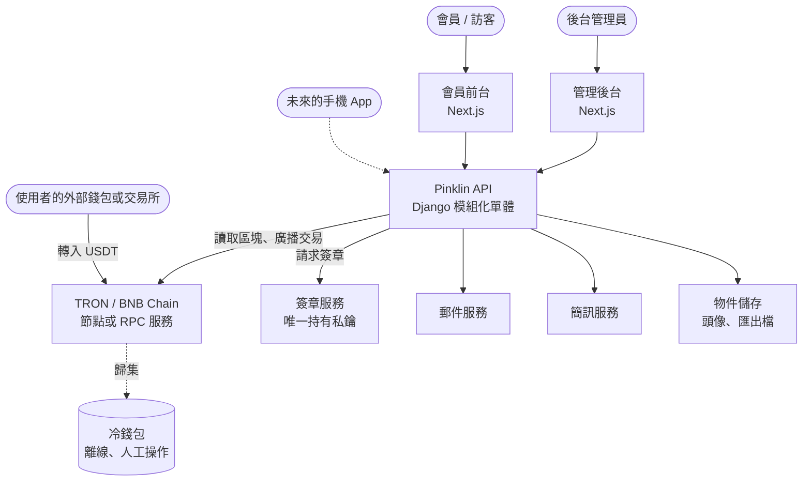
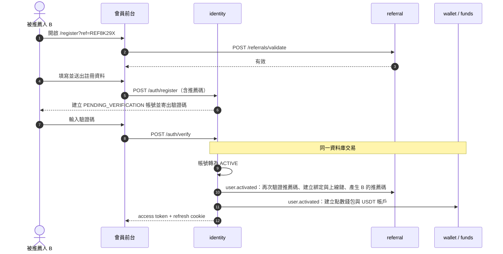
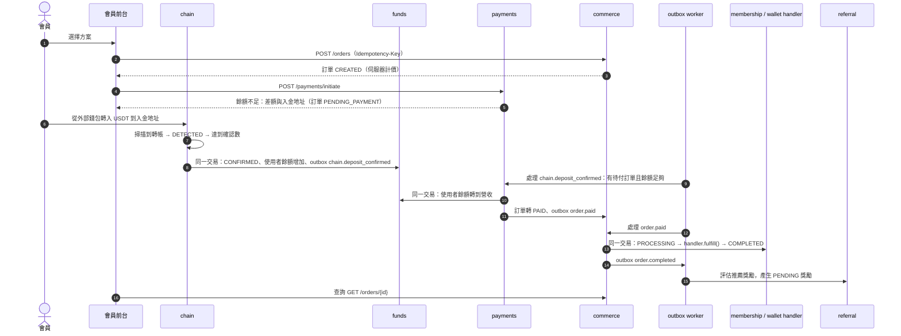
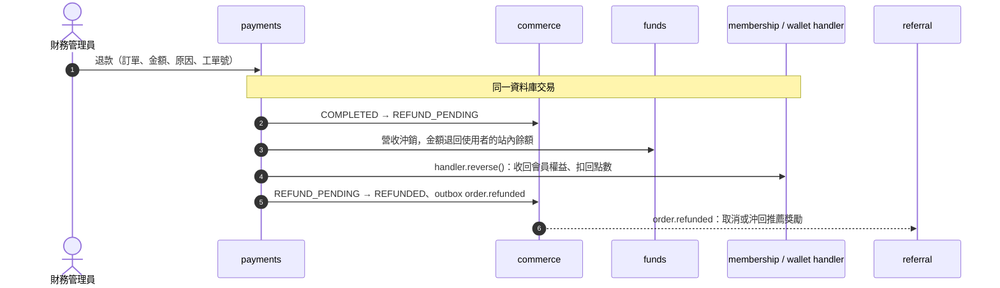

# Pinklin Phase 1 — 架構分析與設計

> **Gate**：本文件 `status: approved` 之前，T-001 不開始寫程式。
> 需求編號（REQ-NNN）與產品決策（D-NN）見 [PRD](project/PRD-project.md)。
> 架構決策以 ADR-NN 編號。本文件核准後，推翻某個決策要新增一筆 ADR，不刪除舊的。

## 1. 架構驅動因素

| 驅動因素 | 來源 | 對架構的影響 |
| --- | --- | --- |
| 金融完整性 | spec §6、§7、§11 | 不可變帳本、資料庫約束與觸發器、列鎖、冪等鍵、outbox、每日對帳 |
| 託管使用者的 USDT | D-01、D-03、D-18 | 私鑰隔離在簽章服務；鏈上只用於入金，付款與退款都在帳本內完成；使用者的 USDT 一律歸集到冷錢包；資金帳本採複式記帳；鏈上對帳 |
| 未來三個產品共用底座 | spec §1、§14 | 模組邊界清楚、以事件與介面互動；權益、點數、訂單做成通用能力 |
| API-first、未來支援手機 App | spec §2 | 所有功能先有 API；token 同時支援 cookie（Web）與 Bearer（App） |
| 不寫死業務規則 | spec §2 | 權益採鍵值設定、商品目錄、獎勵規則表、系統設定表 |
| 支付方式與區塊鏈可擴充 | spec §7、D-01 | 支付方式抽象 + 鏈介接抽象；訂單核心不認識任何鏈 |
| 不過早拆微服務 | spec §2 | 主系統是單一 Django 部署單元與單一 PostgreSQL；唯一例外是簽章服務，因安全隔離必須獨立部署 |
| 安全與稽核 | spec §3、§8、§11 | 集中授權、後台獨立 token 與強制 TOTP、安全日誌、後台稽核與業務異動同一交易寫入 |

## 2. 系統脈絡



## 3. 部署單元（Docker Compose）

| 服務 | 內容 | 備註 |
| --- | --- | --- |
| `proxy` | Caddy 或 Nginx 反向代理 | 會員前台與 `/api` 走同一個 origin，cookie 與 CORS 最單純 |
| `api` | Django + DRF（gunicorn） | 無狀態，可水平擴充 |
| `worker` | Celery worker | outbox 派送、履約、通知、匯出、自動續費 |
| `chain-worker` | Celery worker（專用佇列） | 鏈上掃描、確認數更新、廣播、歸集；每條鏈同一時間只有一個掃描者（PostgreSQL advisory lock） |
| `beat` | Celery beat | 會員到期與續費、點數到期、訂單逾時、獎勵結算、outbox 補派、鏈上掃描、歸集、對帳 |
| `signer` | 簽章服務（獨立的小型 Python 服務） | 只在內部網路，不對外開放；有自己的資料庫與帳號。正式環境放在獨立主機，私鑰由 KMS / HSM 或 MPC 保護（D-15） |
| `db` | PostgreSQL 16+ | 主系統唯一的資料來源；需要 `btree_gist` 擴充 |
| `redis` | Redis 7 | Celery broker、快取、限流計數 |
| `web` | Next.js 會員前台 | |
| `admin` | Next.js 管理後台 | 正式環境放在獨立網域並加 IP 白名單 |
| `mailpit` | 開發用郵件收件器 | 只在 local profile 啟用 |

環境分為 `local`（Mock 鏈）、`test`（Mock 鏈）、`staging`（測試網）、`production`（主網），以 `DJANGO_ENV` 切換設定檔；密鑰一律來自環境變數（REQ-002），私鑰則只存在簽章服務。

## 4. 程式碼結構

```
pinklin/
├─ backend/
│  ├─ config/                 # settings/{base,local,test,staging,production}.py、urls.py、celery.py
│  ├─ apps/
│  │  ├─ core/                # 共用核心：ID、Money、幣別表、錯誤、outbox、冪等、系統設定、合約
│  │  ├─ identity/            # 帳號、驗證碼、session、個人資料
│  │  ├─ access/              # RBAC、管理員 TOTP
│  │  ├─ audit/               # 後台稽核日誌
│  │  ├─ notifications/       # 郵件、簡訊抽象
│  │  ├─ wallet/              # AI 點數錢包（非現金）
│  │  ├─ funds/               # USDT 資金帳本（複式記帳）與使用者餘額
│  │  ├─ commerce/            # 商品目錄、訂單、退款記錄
│  │  ├─ chain/               # 入金地址、鏈上掃描、入金、轉出、歸集、對帳
│  │  ├─ payments/            # 支付方式抽象、餘額付款、退款流程協調
│  │  ├─ membership/          # 會員等級、權益、會員期間、自動續費
│  │  ├─ referral/            # 推薦碼、綁定、獎勵
│  │  └─ reporting/           # 後台儀表板與報表（唯讀）
│  ├─ tests/                  # 跨模組整合與端到端測試
│  └─ pyproject.toml
├─ signer/                    # 簽章服務：獨立的程式碼、依賴與部署，不 import backend 的任何程式
├─ frontend/                  # pnpm workspace
│  ├─ apps/web/               # 會員前台
│  ├─ apps/admin/             # 管理後台
│  └─ packages/{api-client,ui}/
├─ deploy/                    # Dockerfile、proxy 設定
├─ docs/
├─ docker-compose.yml
└─ .env.example
```

每個業務模組內部的結構相同：

```
apps/<module>/
├─ models.py       # 私有：其他模組不得 import
├─ services.py     # 私有：業務邏輯實作
├─ public.py       # 公開介面：其他模組只能呼叫這裡的函式與 DTO
├─ events.py       # 公開：本模組發出的事件與 payload 定義
├─ handlers.py     # 訂閱其他模組的事件
├─ permissions.py  # 本模組宣告的權限代碼
├─ api/            # 會員端 API（/api/v1/...）
├─ admin_api/      # 後台 API（/api/v1/admin/...）
├─ migrations/
└─ tests/
```

## 5. 模組劃分

| 模組 | 職責 | 擁有的資料表 | 發出的事件 |
| --- | --- | --- | --- |
| core | 共用核心：UUIDv7、Money、幣別表、錯誤碼、outbox、冪等工具、系統設定註冊表、履約合約 | `outbox_events`、`outbox_deliveries`、`idempotency_keys`、`system_settings`、`reconciliation_runs` | — |
| identity | 註冊、驗證、登入、session、個人資料、安全日誌 | `users`、`user_profiles`、`user_sessions`、`verification_codes`、`account_status_history`、`security_events` | `user.activated`、`user.suspended`、`user.reactivated` |
| access | 角色、權限、授權檢查、管理員 TOTP | `roles`、`permissions`、`user_roles`、`role_permissions`、`admin_mfa_devices` | — |
| audit | 後台操作稽核 | `admin_audit_logs` | — |
| notifications | 郵件與簡訊抽象、範本 | `notification_logs` | — |
| wallet | AI 點數：批次、帳本、扣點、到期、對帳 | `credit_wallets`、`credit_lots`、`credit_ledger`、`credit_lot_movements` | `wallet.credits_expired`、`wallet.reconciliation_failed` |
| funds | USDT 與手續費資產的複式記帳；使用者餘額 | `fund_accounts`、`fund_journal_entries`、`fund_postings` | `funds.user_balance_credited` |
| commerce | 商品目錄、訂單狀態機、退款記錄、履約調度 | `products`、`product_prices`、`orders`、`order_items`、`order_status_history`、`refund_records` | `order.paid`、`order.completed`、`order.refunded`、`order.cancelled`、`order.expired` |
| chain | 入金地址、鏈上掃描、入金確認、平台內部轉帳（歸集、補手續費）、平台錢包、鏈上對帳 | `deposit_addresses`、`chain_scan_cursors`、`chain_deposits`、`chain_transfers`、`treasury_wallets` | `chain.deposit_confirmed`、`chain.deposit_dropped`、`chain.transfer_confirmed`、`chain.transfer_failed` |
| payments | 支付方式抽象、餘額付款、自動付款、退款（退回站內餘額） | `payment_transactions` | `payment.succeeded`、`refund.completed` |
| membership | 等級、權益、會員期間、會員點數發放、自動續費 | `membership_tiers`、`membership_entitlements`、`membership_plans`、`user_memberships`、`membership_orders` | `membership.activated`、`membership.changed`、`membership.expired`、`membership.renewal_failed` |
| referral | 推薦碼、綁定、獎勵規則、獎勵 | `referral_codes`、`referral_bindings`、`referral_ancestors`、`referral_bind_attempts`、`referral_link_visits`、`referral_referee_activity`、`referral_reward_rules`、`referral_reward_rule_levels`、`referral_rewards` | `referral.bound`、`referral.reward_confirmed` |
| reporting | 儀表板指標、報表匯出 | `export_jobs`（其餘為唯讀查詢，必要時加物化視圖） | — |
| signer（獨立服務） | 持有私鑰、依政策簽署交易 | 自己的資料庫：`sign_requests`、`policy_limits`、`signature_log` | — |

spec §9 列出的資料表全部保留（`webhook_events` 這類 spec 沒有、為外部支付供應商準備的表，本期不建）。
表中沒出現在 spec 的表，是為了冪等、稽核、鏈上收款或模組解耦而加的，詳細欄位會寫在 `DATABASE-ERD.md`。

## 6. 模組依賴規則

```mermaid
flowchart BT
  core[core]
  identity --> core
  audit --> core
  notifications --> core
  access --> identity
  wallet --> identity
  funds --> identity
  commerce --> identity
  chain --> funds
  payments --> commerce
  payments --> funds
  payments --> chain
  membership --> wallet
  membership --> commerce
  membership --> payments
  referral --> commerce
  referral --> identity
  reporting -. 唯讀 .-> membership & referral & wallet & payments & chain
```



箭頭表示「依賴」，只能由上往下依賴：

1. 模組只能 import 其他模組的 `public.py` 與 `events.py`，不得 import `models.py` 或 `services.py`。
2. 下層模組不得依賴上層。下層需要通知上層時，一律透過事件或 `core` 裡的合約（依賴反轉）。
3. 資料庫外鍵只能「往下」指向下層模組的表（例如 `fund_accounts.user_id → users.id`）。往上的引用只存 ID、不建外鍵（例如 `credit_ledger.order_id`），完整性由服務層和每日對帳保證。
4. 以上規則用 `import-linter` 在 CI 檢查（REQ-005、REQ-162）。
5. `signer/` 是獨立程式，與 backend 只透過內部 HTTP API 溝通，CI 另外檢查它沒有 import backend。

**分層理由**：
- wallet（AI 點數）與 funds（USDT）都放在低層：它們是未來 AI Studio、創作者收益等模組會直接使用的基礎元件。
- 點數包與會員方案的履約 handler 透過 `core` 的履約合約註冊，commerce 不需要知道它們存在。
- chain 只負責「鏈上的錢」：入金，以及平台內部的歸集與補手續費。付款、退款都在帳本內完成，不經過 chain（D-18）。

## 7. 模組間溝通

### 7.1 三種方式

| 方式 | 何時用 | 例子 |
| --- | --- | --- |
| 同步呼叫 `public.py` | 上層需要下層的結果，且必須在同一個交易內 | payments 付款時呼叫 `funds.public.transfer()`；membership 發放會員點數時呼叫 `wallet.public.grant()` |
| 交易內訂閱者 | 少數必須和發起動作原子完成的副作用 | `user.activated` → 建立推薦綁定、產生推薦碼、建立點數錢包與 USDT 帳戶 |
| Outbox 非同步事件 | 其他所有跨模組副作用 | `order.paid` → 履約；`order.completed` → 推薦獎勵；`chain.deposit_confirmed` → 自動付款待付訂單 |

交易內訂閱者只能用在上表列出的情境。新增情境需要新的 ADR，因為它會讓不同模組的失敗互相回滾。

### 7.2 履約合約

`core.contracts.fulfillment` 定義 `FulfillmentHandler` 介面：

- `product_type`：處理哪一種商品類型。
- `fulfill(order_item, ctx)`：開通或入帳，必須冪等（以 `order_item.id` 為鍵）。
- `reverse(order_item, refund, ctx)`：退款時的反向處理，必須冪等（以 `refund.id` 為鍵）。

membership 註冊 `MEMBERSHIP_PLAN` 的 handler，wallet 註冊 `CREDIT_PACK` 的 handler。未來的 AI 服務只要新增商品類型並註冊 handler，commerce 不用改（REQ-100、REQ-106）。

## 8. 架構決策（ADR）

### ADR-01 模組化單體，邊界由 CI 強制
- **決策**：單一 Django 專案，每個業務模組一個 Django app；依第 6 節的規則以 `import-linter` 檢查。
- **理由**：spec 明確禁止微服務；單一資料庫才能用資料庫交易保護金融操作。
- **例外**：簽章服務獨立部署（ADR-15），理由是安全隔離，不是業務拆分。
- **代價**：要靠紀律與 CI 維持邊界。好處是未來要拆服務時，outbox 事件可以直接換成訊息佇列。

### ADR-02 驗證：JWT access token + 不透明 refresh token + session 表
- **選項**：(a) `djangorestframework-simplejwt` 的黑名單機制；(b) 自建 session 表，access token 用 JWT、refresh token 用不透明亂數字串。
- **決策**：(b)。用 `PyJWT` 以 EdDSA（Ed25519）簽發 access token（預設 10 分鐘，可設定），內含 `sub`、`sid`（session ID）、`aud`（`member` 或 `admin`）。refresh token 是 256-bit 亂數，只存雜湊值於 `user_sessions`。
- **輪替與重放偵測**（REQ-018）：每次 refresh 都發新的 refresh token；若收到「上一代」token 或已撤銷 session 的 token，就撤銷整個 session 並寫入安全事件。
- **即時撤銷**（REQ-019）：每個請求驗 JWT 後，以 `sid` 查 Redis 快取的 session 狀態與帳號狀態（快取 30 秒，撤銷時主動清除）。停權、改密碼、登出都能在幾秒內生效。
- **Web 與 App**：Web 的 refresh token 放在 `HttpOnly; Secure; SameSite=Strict; Path=/api/v1/auth` cookie，access token 只存在記憶體；App 的 refresh token 放在回應 body。Cookie 端點另外檢查 `Origin` 並要求自訂 header（REQ-150）。
- **後台**：使用獨立的登入端點與 `aud=admin` 的 token，TTL 較短，並強制 TOTP（REQ-035）；會員 token 不能呼叫後台 API。

### ADR-03 自建 RBAC，權限以字串代碼表示
- **選項**：(a) Django 內建的 Group / Permission；(b) 自建 `roles` / `permissions` / `user_roles` / `role_permissions`。
- **決策**：(b)，和 spec §9 的表名一致。Django 內建權限以模型 CRUD 為中心，不適合描述 `wallet.adjust`、`refund.manage` 這類業務動作。
- **作法**：各模組在 `permissions.py` 宣告權限代碼，部署時由同步指令寫入 `permissions` 表；角色與權限的對應存在資料庫，由後台管理。API 以 `RequirePermission("refund.manage")` 宣告所需權限（REQ-032）。
- **資金相關權限**：`refund.manage`、`treasury.view`、`treasury.manage`、`treasury.limits` 分開授權；需要雙人核准的操作（異常入金沖銷、從冷錢包提出資金），「核准者不得是發起者」在服務層檢查，不靠權限設定。
- **會員等級不進 RBAC**：等級由 membership 的權益服務判斷（REQ-033）。

### ADR-04 金額與幣別
- **最小單位整數**：現金金額一律以「最小單位的整數」儲存，欄位型別 `NUMERIC(38,0)`。不用 `BIGINT` 的原因是手續費資產 BNB 有 18 位小數，會超出 `BIGINT` 範圍。
- **幣別表**：`core` 維護幣別註冊表（代碼、小數位、類型）：USDT = 6 位、TRX = 6 位、BNB = 18 位。`core.Money` 值物件禁止不同幣別相加。
- **鏈上原始數量**：另以 `NUMERIC(78,0)` 保存，可容納 uint256。BEP-20 USDT 鏈上是 18 位小數，換算為站內 6 位時，多出的小數位捨去，差額記錄在入金記錄上供稽核。
- **點數**：`BIGINT` 整數，只存在 wallet。
- **百分比計算**：先用 `Decimal` 計算，再依 `BUSINESS-RULES.md` 的捨入規則轉回整數。
- **現金與點數分開**：USDT 只出現在 funds、chain、payments、commerce 與推薦獎勵；點數只出現在 wallet（REQ-117）。

### ADR-05 點數錢包：批次 + 不可變帳本 + 錢包列鎖
- **資料**：`credit_wallets`（餘額快取）、`credit_lots`（每次入帳一個批次）、`credit_ledger`（每筆交易一列，記錄異動前後餘額）、`credit_lot_movements`（一筆交易從哪些批次各扣了多少）。
- **併發**：任何異動先 `SELECT ... FOR UPDATE` 鎖住該錢包列，再處理批次與帳本。一個交易只鎖一個錢包，避免死結（REQ-089）。
- **資料庫約束**：`balance >= 0`；`0 <= remaining <= original`；`balance_after = balance_before + amount`；`UNIQUE(wallet_id, idempotency_key)`；帳本與 movements 以觸發器禁止 `UPDATE` / `DELETE`（REQ-087、REQ-088）。
- **到期**：每次異動前，先把該錢包已到期的批次做到期處理；排程任務另外定期掃描（REQ-090）。
- **對帳**：每日檢查「餘額 = 有效批次剩餘量總和 = 帳本累計」，不一致就告警，不自動修正（REQ-092）。
- **唯一入口**：只有 `wallet.public` 能異動點數，後台調整也一樣（REQ-093）。

### ADR-06 訂單狀態機與付款
- **狀態機**：允許的轉換寫成程式中的轉換表；資料庫以 `CHECK` 限制狀態值；轉換使用「比對舊狀態再更新」並寫入 `order_status_history`（REQ-103）。完整轉換表在 `PAYMENT-FLOW.md`。
- **支付方式抽象**：`PaymentMethod` 介面只有 `pay(order)` 與 `refund(order, refund)`。第一個實作是 `UsdtBalance`（REQ-106）。
- **付款 = 帳本內部轉帳**：同一交易內鎖住訂單 → 從使用者餘額帳戶轉到營收帳戶 → 寫入 `payment_transactions` → 訂單轉 `PAID` → 寫入 outbox `order.paid`（REQ-174）。不需要等外部回呼，所以沒有「前端說付款成功」的問題。
- **退款 = 帳本內部轉帳**：營收沖銷、金額退回使用者餘額，與反向處理在同一交易內完成（ADR-19）。
- **「只信任後端確認」落在入金**：使用者的錢只有一個進來的管道：鏈上入金。只有後端監聽、合約正確、且達到確認數的轉入才會增加餘額（ADR-17）。
- **餘額不足**：回傳差額與入金地址，訂單維持 `PENDING_PAYMENT`；入金入帳後，若開啟自動付款就自動完成（REQ-175），逾時則 `EXPIRED`，錢留在餘額。
- **履約**：worker 處理 `order.paid`：第一個交易把訂單轉為 `PROCESSING`；第二個交易呼叫對應的 handler 並轉為 `COMPLETED`。拆成兩個交易，卡住的訂單才查得出來。可重試，超過上限轉 `FAILED` 並告警（REQ-110，詳見 `PAYMENT-FLOW.md` §7）。
- **前端**：付款結果頁只查詢後端狀態（REQ-142）。

### ADR-07 Outbox + 消費端去重
- **決策**：業務異動與 `outbox_events` 在同一交易寫入；交易提交後立即觸發派送任務，另有排程每幾秒補派。派送用 `SELECT ... FOR UPDATE SKIP LOCKED` 批次取件。
- **語意**：寫入事件時，同時為每個訂閱者建立一列 `outbox_deliveries`；訂閱者在自己的交易內完成處理，並把該列標為 `DONE`。因此事件至少送達一次，效果只生效一次。重試用盡的標為 `DEAD` 並告警（REQ-006）。
- **不採用**：只用 `transaction.on_commit` 直接丟 Celery。broker 或 worker 當機時事件會遺失，不能用在金流。

### ADR-08 後台：獨立的 Next.js 後台 + 各模組自己的後台 API
- **選項**：(a) Django Admin；(b) 獨立的 Next.js 後台，呼叫 `/api/v1/admin/*`。
- **決策**：(b)。spec 要求 API-first、權限在伺服器端強制、所有調整都要附原因並稽核；Django Admin 很容易繞過服務層直接改資料表，違反 REQ-093。
- **Django Admin**：正式環境預設關閉；開發環境只開唯讀檢視。
- **後台 API 放置**：每個模組在自己的 `admin_api/` 實作，掛載在 `/api/v1/admin/<module>/`；所有寫入操作在同一交易內寫入 `admin_audit_logs`（REQ-129）。

### ADR-09 識別碼
- **決策**：所有業務表主鍵用 UUIDv7（依時間排序，索引友善；Python 3.12 沒有內建，在 `core` 自行實作，不加依賴）。對外不暴露任何流水號。
- **人看的識別碼**：訂單編號（REQ-102）、推薦碼（REQ-060）另外產生。
- **HD 衍生序號**：入金地址的衍生序號是內部流水號，只存在 `deposit_addresses`，不對外暴露。

### ADR-10 設定分兩層
- **環境變數**：基礎設施與密鑰（資料庫、Redis、JWT 簽章金鑰、RPC 端點與 API key、簽章服務的連線憑證），使用 `django-environ` 讀取。
- **`system_settings`**：業務參數，包含各鏈確認數、歸集門檻、轉出限額、寬限期（REQ-007、D-16）。每個 key 都在程式中註冊型別、預設值與驗證規則，存 JSONB，以 Redis 快取，後台修改時寫入稽核。密鑰永遠不進這張表。
- **USDT 合約地址**：寫在部署設定，不開放後台修改；上線前以發行方官方公布的地址（TRON 為 Tether；BNB Chain 為 Binance-Peg BSC-USD）由兩人覆核。

### ADR-11 時間
- 資料庫一律 `TIMESTAMPTZ`、`USE_TZ=True`，儲存 UTC（REQ-155）。
- 「每日」相關的邏輯（每日上限、每日轉出上限、報表日界）依系統設定 `business_timezone`（D-09）。

### ADR-12 通知
- `notifications` 模組定義 `EmailSender`、`SmsSender` 介面；開發環境使用 Mailpit 與 console，正式供應商以 adapter 接入。
- 所有發送都透過 Celery 非同步執行；驗證碼簡訊另有每號碼、每 IP、每國碼的發送上限（防簡訊灌量）。

### ADR-13 前端
- pnpm workspace：`apps/web`、`apps/admin`、`packages/api-client`、`packages/ui`；Next.js App Router + TypeScript + Tailwind。
- `api-client` 由後端 OpenAPI 自動產生型別（`openapi-typescript` + `openapi-fetch`），契約不一致時編譯失敗（REQ-143）。
- 前端不做任何金額、點數、權益計算；價格、餘額、入金確認進度都以 API 回應為準（REQ-142）。
- 入金頁的地址與 QR code 由後端提供；前端只負責顯示與鏈別警示（REQ-182）。

### ADR-14 測試策略
- `pytest` + `pytest-django` + `factory_boy`；測試資料庫一律用 Docker 中的真實 PostgreSQL 與 Redis（REQ-161）。
- 併發測試用 `transaction=True` 搭配多執行緒或多程序，同時對同一錢包、同一使用者餘額、同一訂單發請求。
- 鏈上相關測試使用 Mock 鏈（可控制區塊高度、確認數、重組、仿冒代幣）與 Mock 簽章服務（REQ-107）；staging 另跑測試網的端到端流程。
- spec §12 的支付測試改寫為：入金確認入帳與餘額付款成功、仿冒合約或未達確認數不入帳、同一筆鏈上轉帳重複掃描只入帳一次、訂單付款逾時、管理員退款退回餘額並完成反向處理。
- 點數錢包、資金帳本、訂單狀態機、獎勵計算、簽章政策另外跑 mutation testing（`mutmut`），依工作流程記錄分數。

### ADR-15 自管錢包與金鑰管理
- **HD 錢包**：TRON 與 BNB Chain 各一組 BIP-32 / BIP-44 金鑰樹（TRON 路徑 `m/44'/195'/…`、BNB Chain 路徑 `m/44'/60'/…`）。每位使用者每條鏈分配一個固定的衍生序號（REQ-170）。
- **主系統只持有擴展公鑰**：用來衍生入金地址；看得到地址，但無法動用資金。
- **簽章服務是唯一持有私鑰的元件**：
  - 獨立程式碼、獨立容器、只在內部網路；與主系統之間使用雙向 TLS 或 HMAC 驗證請求。
  - 只簽署、不廣播：回傳已簽交易，由 chain-worker 廣播。簽章服務因此不需要對外網路。
  - 自己保存請求冪等記錄與簽章日誌。
- **政策在簽章服務內獨立執行**（REQ-178）：
  - 歸集：來源必須是入金地址，目的地只能是登記的冷錢包。
  - 補手續費：只能從熱錢包轉到入金地址，金額有單筆與每日上限。
  - 本期沒有任何轉到外部地址的用途，簽章服務直接拒絕這類請求（D-18）。
  - 主系統即使被入侵，也只能讓錢在平台自己的地址之間移動；可能的損失只限於熱錢包裡的手續費資產。
- **正式環境的私鑰保護**（D-15）：主種子以 KMS / HSM 信封加密，或改用 MPC 服務；助記詞離線備份並分持（例如分割成多份由不同人保管）。
- **冷錢包**：不在系統內；使用硬體錢包或多簽地址。使用者的 USDT 一律歸集到這裡；任何轉出都由人工操作，再到後台登記（REQ-180）。

### ADR-16 USDT 資金帳本採複式記帳
- **理由**：平台現在代管使用者的錢，必須隨時證明「使用者餘額 + 平台收入 − 已轉出 = 平台在鏈上實際持有的資產」。複式記帳讓這件事由資料結構保證，而不是靠事後拼湊。
- **帳戶類型**：
  - 使用者 USDT 餘額（負債）
  - 各鏈入金地址彙總、熱錢包、冷錢包（資產）
  - 營收、退款（收入與沖銷）
  - 鏈上手續費（費用，以 TRX / BNB 計）
  - 暫記帳戶（異常入金）
- **約束**：
  - 每筆分錄內，每個幣別的借貸合計為 0（延遲檢查的約束觸發器）。
  - 分錄與分錄明細不可修改。
  - 使用者帳戶餘額不得為負（`CHECK`）。
  - 同一交易需要鎖多個帳戶時，依帳戶 ID 排序加鎖，避免死結。
- **與點數錢包的關係**：完全分開的模組與資料表，符合 spec §9「現金與點數分開、不用單一餘額欄位」。

### ADR-17 鏈上監聽
- **介接抽象**：`ChainAdapter` 介面提供這些操作：
  - 取得最新與已確定的區塊高度
  - 掃描指定區塊範圍內某合約的轉帳事件
  - 查詢交易狀態
  - 廣播已簽交易
  - 查詢地址餘額
- **實作**：TRON（HTTP API）、BNB Chain（EVM JSON-RPC 的 `eth_getLogs`）、Mock。每條鏈設定主要與備援 RPC 來源。
- **掃描**：
  - 依 `chain_scan_cursors` 批次推進，只看設定中的官方 USDT 合約。
  - 以 `(chain, tx_hash, log_index)` 唯一鍵寫入 `chain_deposits`，重複掃描不會重複記錄（REQ-172）。
  - 轉入地址比對 `deposit_addresses`；比對不到的記為異常入金（REQ-184）。
- **確認與入帳**：入金先記為 `DETECTED`，確認數達到設定值（TRON 以已確定區塊為準）後，在同一交易內轉為 `CONFIRMED`、記帳到使用者餘額並寫入 outbox（REQ-171）。
- **重組**：未確認的入金若在後續掃描中消失，轉為 `DROPPED`，不入帳；已確認的入金若被重組（理論上不應發生），立即告警並由財務人工沖正。

### ADR-18 歸集與手續費
- **歸集條件**：入金地址的 USDT 超過門檻時，排程建立歸集任務。
- **TRON**：TRC-20 轉帳需要能量與頻寬。優先由平台的質押帳戶委派能量給入金地址；不足時補 TRX。
- **BNB Chain**：先轉入少量 BNB 當作 gas，再轉出 USDT。
- **記帳**：每一步都是 `chain_transfers` 的一筆記錄並記入資金帳本：USDT 從「入金地址彙總」轉到「冷錢包」，手續費記為費用（REQ-177）。
- **熱錢包**：本期只存放手續費資產（TRX、BNB），不存 USDT；低於下限時告警，由財務購入後登記（REQ-180）。

### ADR-19 退款在帳本內完成
- **決策**：退款一律退回使用者的站內 USDT 餘額，不做鏈上轉帳（D-06、D-18）。一位具 `refund.manage` 權限的管理員即可完成，必須填寫原因與工單號。
- **理由**：鏈上轉帳不可逆，還要管理收款地址與熱錢包流動性，風險與成本都高。錢留在平台內時，退錯了還能以帳務更正。真正讓錢離開平台的是未來的出金，屆時在那裡審核（每筆人工審核，D-14）。
- **作法**：一個資料庫交易完成全部步驟：訂單 `REFUND_PENDING → REFUNDED`、資金分錄（借營收沖銷、貸使用者餘額）、handler 的 `reverse()`、稽核日誌、outbox `order.refunded`（referral 撤銷或沖回獎勵）。任何一步失敗就整筆回滾。
- **狀態機**：`REFUND_PENDING` 在本期只存在於交易內；保留它是為了符合 spec 的狀態機，也方便未來接入需要非同步退款的支付方式。

### ADR-20 自動續費
- `user_memberships` 有 `auto_renew` 欄位，使用者可隨時開關。
- 排程在到期前（預設 24 小時）以冪等鍵 `membership:{id}:renew:{period_no}` 建立續費訂單，以目前商品價格從餘額扣款；價格變動需提前通知。
- 扣款成功：新期間接在原到期時間之後。
- 扣款失敗：到期後進入寬限期（預設 3 天）。寬限期內保留權益並每日重試；仍失敗則到期降回 Free，續費訂單轉為 `EXPIRED`，並發出 `membership.renewal_failed`。
- 已排定的降級：續費時改用降級後的方案計價。
- 到期前若預估餘額不足，提前提醒儲值（REQ-053、REQ-176）。

### 主要依賴
- **後端**：Django 5.2 LTS、Django REST Framework、drf-spectacular、psycopg 3、Celery、redis-py、django-environ、PyJWT、cryptography（EdDSA 簽章與欄位加密）、argon2-cffi、django-cors-headers、Pillow、pyotp、phonenumbers；正式環境另加 django-storages + boto3。
- **鏈上**：`web3.py`（BNB Chain）、TRON 的 Python SDK、HD 金鑰衍生函式庫。後兩者需在 T-020 評估維護狀況與安全紀錄後再選定；簽章服務使用同一組函式庫的最小子集。
- **開發**：pytest、pytest-django、factory_boy、import-linter、ruff、mypy + django-stubs、mutmut。
- 每加一個依賴都要能說明理由（spec §15 第 12 條）。

## 9. 資料架構概覽

完整欄位、索引與 ERD 會寫在 `DATABASE-ERD.md`。以下是全部資料表必須遵守的共同規則：

- 主鍵 UUIDv7；所有表有 `created_at`；可變更的表另有 `updated_at`。
- 狀態欄位以 `CHECK` 限制可用值。
- 唯一性由資料庫保證，例如：
  - `users.email_normalized`、`users.phone_e164`、`lower(users.username)` 各自唯一。
  - `referral_codes.code` 唯一；每個使用者最多一個有效推薦碼（部分唯一索引 `WHERE status='ACTIVE'`）。
  - `referral_bindings.referee_id` 唯一。
  - `referral_rewards` 的 `(order_id, level)` 唯一（限 `kind = 'REWARD'`）。
  - `deposit_addresses` 的 `(chain, address)` 與 `(chain, user_id)` 各自唯一。
  - `chain_deposits` 的 `(chain, tx_hash, log_index)` 唯一。
- 會員期間不可重疊：`user_memberships` 以 `btree_gist` 排除約束保證同一使用者的有效期間不重疊。
- 只能新增的表以觸發器禁止 `UPDATE` / `DELETE`：
  - `credit_ledger`、`credit_lot_movements`
  - `fund_journal_entries`、`fund_postings`
  - `admin_audit_logs`、`security_events`
  - `order_status_history`、`referral_bindings`、`referral_ancestors`
- 金融資料不做軟刪除；更正一律新增反向記錄。
- 正式環境的應用程式資料庫帳號沒有 DDL 權限；migration 使用另一個帳號執行。簽章服務的資料庫與主系統完全分開。

## 10. 交易邊界

| 操作 | 同一交易內的內容 | 鎖 | 冪等依據 |
| --- | --- | --- | --- |
| 驗證成功、帳號啟用 | 帳號轉 `ACTIVE`、推薦綁定與上線鏈、產生推薦碼、建立點數錢包與 USDT 帳戶 | 使用者列 | 驗證碼一次性 |
| 入金確認 | 入金轉 `CONFIRMED`、資金分錄（入金地址資產 ↑、使用者餘額 ↑）、outbox | 入金列 + 相關帳戶 | `(chain, tx_hash, log_index)` |
| 以餘額付款 | 資金分錄（使用者餘額 ↓、營收 ↑）、付款記錄、訂單 `PAID`、outbox | 訂單列 + 相關帳戶 | `order.id`（每張訂單只能付款一次） |
| 點數入帳、扣點、調整 | 錢包餘額、批次、帳本、movements；後台調整另含稽核日誌 | 錢包列 | `(wallet_id, idempotency_key)` |
| 建立訂單 | 訂單、明細、狀態歷史 | — | `(user_id, Idempotency-Key)` |
| 履約 | 訂單 `PROCESSING → COMPLETED`、handler 的效果（會員期間或點數批次）、outbox | 訂單列 + handler 內的錢包列 | `order_item.id` |
| 推薦獎勵評估 | 第 1 ~ N 層的獎勵記錄 | — | 每張訂單每一層最多一筆獎勵（唯一鍵） |
| 退款 | 退款記錄、訂單 `REFUND_PENDING → REFUNDED`、資金分錄（營收沖銷、使用者餘額增加）、各 handler 的反向處理、稽核日誌、outbox | 訂單列 + 相關帳戶 + handler 內的錢包列 | 每張訂單只能退款一次 |
| 歸集或補手續費確認 | 轉出記錄 `CONFIRMED`、資金分錄（含手續費） | 轉出列 + 相關帳戶 | `chain_transfers.id` |
| 系統設定變更 | 設定值、稽核日誌 | 設定列 | — |

鎖的順序固定為：使用者 → 訂單 → 資金帳戶（依 ID 排序）→ 點數錢包。

## 11. 關鍵流程

### 11.1 推薦註冊（J1）



### 11.2 儲值與購買（J2、J3）



餘額足夠時，第 4 步直接完成付款，不需要經過入金。

### 11.3 管理員退款（J5）



退款不經過鏈上（D-18）。使用者要把錢轉出平台，要等未來的出金模組（D-14）。

## 12. API 慣例與 spec 端點整理

- **路徑**：`/api/v1/` 加資源名稱，統一不加結尾斜線（spec 的 admin 路徑有結尾斜線，實作時統一拿掉）。
- **成功回應**：直接回傳資源，不包信封。
- **錯誤回應**：`{"error": {"code", "message", "details", "request_id"}}`（REQ-004）。
- **分頁**：帳本、交易紀錄用 cursor 分頁；後台列表用頁碼分頁。
- **冪等**：建立訂單、付款等寫入端點接受 `Idempotency-Key` header。

spec §10 的端點需要補充或整理的地方：

| 項目 | 處理方式 |
| --- | --- |
| 缺少驗證相關端點 | 補 `POST /auth/verify`、`POST /auth/verification/resend`、`POST /auth/password/reset/confirm`、`POST /auth/logout-all` |
| `POST /payments/initiate` | 保留路徑，語意改為「以站內餘額付款」：成功回傳已付款的訂單；不足則回傳差額與入金地址 |
| `POST /payments/webhooks/{provider}` | 本期不實作（沒有外部支付供應商），路徑保留給未來 |
| USDT 餘額與入金 | 補 `GET /funds/balance`、`GET /funds/transactions`、`GET /funds/deposit-addresses`、`GET /funds/deposits` |
| `/members/me/membership` 與 `/memberships/me` 重複 | 以 `/memberships/me` 為主，前者保留為別名 |
| `/memberships/purchase`、`/memberships/renew`、`/wallet/credits/purchase` 與 `POST /orders` 重疊 | 前三者是便利端點，內部都呼叫 commerce 建立訂單，回傳同一種訂單物件；之後一律走 `/payments/initiate` |
| 會員升降級與自動續費 | 補 `POST /memberships/upgrade`、`POST /memberships/downgrade`（排程）、`PATCH /memberships/me/auto-renew` |
| `GET /referrals/me/members` 會暴露被推薦人資料 | 只回傳遮罩後的 username、註冊日期、是否已付費；多層時可依層查詢，但不顯示下線是透過誰加入的 |
| 後台 | 補 `/api/v1/admin/auth/*`（獨立 audience + TOTP）、`/api/v1/admin/refunds`（退回站內餘額）、`/api/v1/admin/treasury/*`（入金、歸集、冷熱錢包、異常入金、對帳結果） |

完整的端點、請求與回應結構、錯誤碼與權限會寫在 `API-SPECIFICATION.md`。

## 13. 安全架構摘要

詳細內容會寫在 `SECURITY-DESIGN.md` 與 `CHAIN-CUSTODY.md`。

- **身分**：Argon2id 密碼雜湊；驗證碼、refresh token、密碼重設碼只存雜湊（REQ-153）。
- **授權**：所有 API 預設拒絕；每個 view 都必須宣告權限，未宣告的 view 讓測試失敗。管理員強制 TOTP。
- **限流**：Redis 計數，分為匿名、已登入、敏感端點三級；登入另有依帳號的漸進式鎖定（REQ-021、REQ-152）。
- **私鑰**：只存在簽章服務；主系統只有擴展公鑰。簽章政策獨立執行，限制最大損失（ADR-15）。
- **鏈上風險**：
  - 只認可官方 USDT 合約，避開仿冒代幣。
  - 達到確認數才入帳，避開區塊重組。
  - 本期沒有轉到外部地址的鏈上轉帳，簽章服務會拒絕這類請求。
  - 入金地址或冷錢包若被代幣發行方（Tether 或 Binance）凍結，立即告警並暫停該鏈的歸集。
- **稽核**：安全事件（`security_events`）與後台操作（`admin_audit_logs`）分開存放，都只能新增；簽章服務另有自己的簽章日誌。
- **個資**：日誌遮罩；後台列表預設部分遮罩；匯出需要專屬權限，且匯出行為本身也要稽核（REQ-127、REQ-154）。

## 14. 可觀測性與營運

- **日誌**：JSON 結構化日誌，每個請求與 Celery 任務都帶 `request_id`，並沿事件鏈傳遞 `correlation_id`。
- **需要告警的情況**：
  - 點數對帳或資金對帳不一致；資金分錄借貸不平衡
  - 訂單 `FAILED`；自動續費失敗率異常
  - 鏈上掃描落後超過 N 個區塊；RPC 來源失效或主備資料不一致
  - 入金卡在 `DETECTED` 太久；已確認的入金遭重組
  - 熱錢包的手續費資產低於下限
  - 簽章服務拒絕簽署；轉出失敗
  - 異常入金佇列有新項目
  - outbox 積壓超過 N 秒；簡訊發送量異常
- **排程任務**：
  - 會員與帳務：會員到期與續費、點數到期、訂單逾時、獎勵結算
  - 鏈上：掃描、確認數更新、歸集
  - 系統：outbox 補派、每日點數對帳與資金對帳
  - 所有排程都可重複執行（冪等）。
- **備份**：PostgreSQL 每日備份加 WAL 歸檔（正式環境）；簽章服務的金鑰備份程序另寫在 `CHAIN-CUSTODY.md`；在部署指南中說明如何演練還原。

## 15. 未來擴充

| 未來需求 | Phase 1 預留的擴充點 | 需要改核心嗎 |
| --- | --- | --- |
| AI Studio 扣點 | `wallet.public.consume()` 已有 `generation_job_id`；之後可加 `credit_holds`，提供「預扣、確認、釋放」三步 | 不需要，只新增帳目類型與一張表 |
| AI 生成權限與每日上限 | 權益鍵值 + 權益驗證服務 + 每日用量計數（REQ-050、REQ-052） | 不需要，只新增權益鍵 |
| 購買 AI 服務 | 新商品類型 + 註冊履約 handler | 不需要 |
| 出金、推薦獎勵提領 | 簽章服務、轉帳生命週期、限額、鏈上對帳都已建好；出金模組新增 `WITHDRAWAL` 用途、熱錢包的 USDT 與審核流程（每筆人工審核、向使用者收固定手續費，D-14） | 不需要，新增出金模組 |
| 更多鏈或幣種 | `ChainAdapter` 新增實作；幣別表新增幣別 | 不需要 |
| 法幣或第三方支付 | `PaymentMethod` 新增實作；屆時再實作 webhook 端點 | 不需要 |
| 創作者與收益 | RBAC 新增 `creator` 角色；新模組 `creator`、`earnings` 使用資金帳本的新帳戶類型 | 不需要 |
| 短影音 | 新模組 `video` 依賴 identity、access、membership | 不需要 |
| 手機 App | Bearer token、refresh token 放在 body、API 版本化 | 不需要 |
| 拆成微服務 | 模組邊界 + outbox 事件可以直接改走訊息佇列 | 只改部署方式 |

## 16. 風險與緩解

| # | 風險 | 緩解 |
| --- | --- | --- |
| R1 | 範圍大，一次做太多容易失控；鏈上收款讓 Phase 1 多出 4 個任務 | 拆成 24 個任務（T-000 ~ T-023），每個任務都要走完 TECH → TEST-SPEC → RED → GREEN → REVIEW；鏈上任務可與身分、會員任務平行 |
| R2 | 金融邏輯錯誤造成資產不一致 | 資料庫約束與觸發器、不可變帳本、複式記帳、併發測試、mutation testing、每日對帳 |
| R3 | 私鑰外洩或主系統被入侵 | 私鑰只在簽章服務；簽章服務只允許平台地址之間的轉帳；使用者的 USDT 在離線冷錢包；熱錢包只有手續費資產 |
| R4 | 託管資金的法規責任（D-17） | 上線前法務確認；保留風險篩查掛勾；條款明確說明不可提領與退款政策 |
| R5 | 使用者轉錯鏈或轉錯代幣 | 入金頁清楚警示；仿冒代幣不入帳；錯誤入金由財務依政策人工處理 |
| R6 | 熱錢包手續費資產不足，無法歸集 | 低水位告警；財務購入 TRX、BNB 後登記；歸集延後不影響使用者餘額 |
| R7 | RPC 服務中斷或回傳錯誤資料 | 主備來源；大額入金可雙來源比對；掃描落後告警 |
| R8 | 平台地址被代幣發行方（Tether 或 Binance）凍結 | 冷錢包與入金地址分開；偵測到凍結即暫停該鏈歸集並告警 |
| R9 | 鏈上手續費上漲讓歸集成本過高 | 歸集門檻可設定；TRON 使用質押委派能量；手續費記帳可追蹤 |
| R10 | 簡訊灌量造成費用暴增 | 每號碼、每 IP、每國碼限流；預留 CAPTCHA 掛勾；發送量告警 |
| R11 | 自建假帳號刷推薦獎勵 | 驗證完成才綁定（D-13）、結算延遲、退款撤銷、記錄 IP 與裝置訊號（多層時每一層分別比對）、管理員可停用推薦碼 |
| R12 | 模組邊界逐漸被破壞 | `import-linter` 在 CI 擋下違規 |
| R13 | 多層推薦獎勵可能被認定為多層次傳銷（D-19、D-17） | 層數預設 1；調高前需法務確認；上限 10 層寫在程式裡；修改寫入稽核日誌 |

## 17. 設計文件索引（T-000，目前皆為 draft）

| 文件 | 內容 | 依賴的決策 |
| --- | --- | --- |
| `DATABASE-ERD.md` | 全部資料表的欄位、型別、約束、索引、觸發器、ERD 圖 | D-05 |
| `API-SPECIFICATION.md` | 端點清單、請求與回應結構、錯誤碼目錄、權限對照 | D-12 |
| `BUSINESS-RULES.md` | 所有 D 決策的最終版、升級與退款金額公式、捨入規則、自動續費時序、各種狀態轉換 | D-04、D-05、D-07 ~ D-09 |
| `SECURITY-DESIGN.md` | 威脅模型、驗證與授權細節、限流參數、權限矩陣 | D-11、D-17 |
| `PAYMENT-FLOW.md` | 訂單狀態轉換表、支付方式介面、餘額付款、入金後自動付款、退款（退回站內餘額）、例外處理 | D-06、D-16 |
| `REFERRAL-FLOW.md` | 推薦碼產生、綁定與上線鏈、多層獎勵計算、結算與撤銷 | D-07、D-08、D-13、D-19 |
| `WALLET-LEDGER.md` | 點數帳目類型、扣點演算法、到期、沖正、對帳 SQL；資金帳本的帳戶表與分錄範例 | D-05 |
| `CHAIN-CUSTODY.md`（spec 未列，新增） | HD 衍生、簽章服務介面與政策、冷熱錢包作業、歸集、金鑰備份與輪替、事故處理手冊 | D-15、D-16 |

## Decision log
- 2026-11-26 — 初版：ADR-01 ~ ADR-14。
- 2026-11-26 — 依 PRD 決策 D-01 ~ D-06 改版（本文件仍為 draft，直接修訂）：
  - 修改 ADR-01、02、03、04、06、10、13、14。
  - 新增 ADR-15 ~ ADR-20。
  - 新增 funds、chain 模組與簽章服務，移除 webhook 相關設計。
- 2026-11-26 — 撰寫其餘設計文件時同步修正：
  - `processed_events` 改為 `outbox_deliveries`。
  - 補列 `product_prices`、`reconciliation_runs`、`notification_logs`、`export_jobs`、`referral_bind_attempts`、`referral_referee_activity`。
  - 履約拆成兩個交易；JWT 改用 EdDSA。
  - BNB Chain 的 USDT 發行方更正為 Binance。
- 2026-11-26 — 依 D-18（鏈上只用於入金與未來的出金）與修訂後的 D-06：
  - ADR-19 改為「退款在帳本內完成」：退回站內餘額，一位管理員即可。
  - ADR-15、ADR-18 改為「USDT 一律歸集到冷錢包，熱錢包只放手續費」，簽章服務拒絕所有轉到外部地址的請求。
  - 更新 §11.3 退款流程圖、交易邊界與風險表。
- 2026-11-26 — 依 D-19（推薦獎勵層數由管理員設定）：
  - referral 模組新增 `referral_ancestors`（上線鏈）與 `referral_reward_rule_levels`（各層獎勵）。
  - 更新唯一鍵、只能新增的表、交易邊界、§11.1 流程圖；風險表新增 R13。
