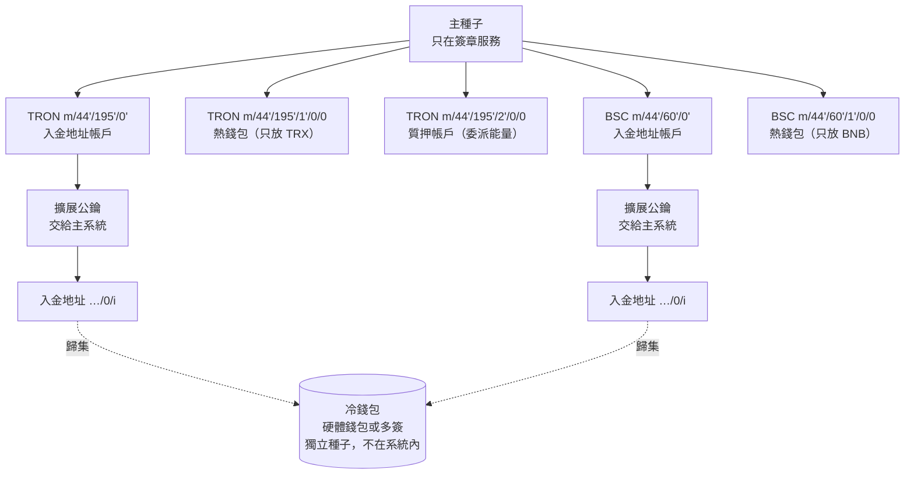
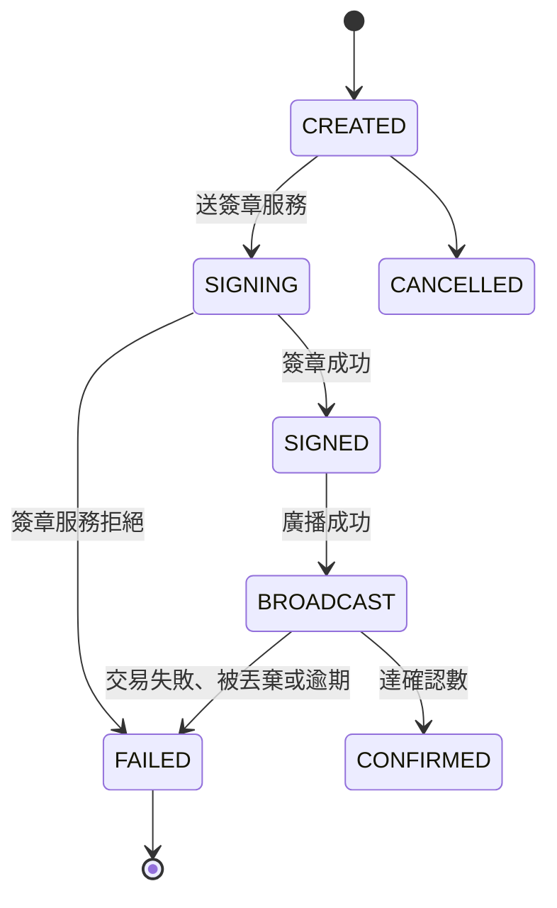

# 鏈上收款與資金託管

> spec 沒有列出這份文件；因 D-01（USDT 自建收款、自管錢包）新增。
> 涵蓋 REQ-107、REQ-170 ~ REQ-172、REQ-177、REQ-178、REQ-180 ~ REQ-185。
> 架構決策見 `ARCHITECTURE.md` ADR-15 ~ ADR-18；記帳見 `WALLET-LEDGER.md` 第二部分；資料表見 `DATABASE-ERD.md` §10。

## 1. 原則

1. **鏈上只用於入金**（D-18）：付款、退款、獎勵都在平台帳本內完成。本期沒有任何轉給使用者或外部地址的鏈上轉帳；出金留給未來模組（D-14）。
2. **私鑰只在簽章服務**：主系統只有入金用的擴展公鑰，看得到地址，動不了錢。
3. **錢只在平台自己的地址之間移動**：使用者的 USDT 從入金地址歸集到冷錢包；熱錢包只放手續費。簽章服務拒絕任何轉到外部地址的請求，主系統被入侵也無法把錢轉出平台。
4. **入帳只信任鏈上確認**：只認可設定中的 USDT 合約，達到確認數才入帳；大額入金要第二個資料來源確認。
5. **每一筆錢都記帳**：入金、歸集、補手續費、平台資金的投入與提出，全部記入資金帳本，每日與鏈上對帳。

## 2. 支援的鏈

| 項目 | TRON | BNB Chain |
| --- | --- | --- |
| 代號 | `TRON` | `BSC` |
| 代幣標準 | TRC-20 | BEP-20 |
| USDT 發行方 | Tether | Binance（Binance-Peg BSC-USD，與 Tether 直接發行的 USDT 不同，發行方風險不同） |
| 鏈上小數位 | 6 | 18 |
| 手續費 | 能量與頻寬；不足時燃燒 TRX | BNB（gas） |
| 預設確認數 | 20 個區塊（約 1 分鐘） | 15 個區塊（約 45 秒） |
| 地址格式 | Base58Check，`T` 開頭 | `0x` 開頭，EIP-55 大小寫校驗 |
| 測試網 | Nile | BNB Chain Testnet |

- **合約地址**：寫在部署設定（`CHAIN_TRON_USDT_CONTRACT`、`CHAIN_BSC_USDT_CONTRACT`），不開放後台修改。上線前由兩人依發行方官方公布的資訊各自覆核。
- **站內換算**：兩條鏈的 USDT 都換算為站內 6 位小數；BEP-20 多出的 12 位無條件捨去，捨去量記在 `chain_deposits.truncated_raw`。

## 3. 金鑰架構



- 主系統只拿到兩條鏈「入金地址帳戶」的擴展公鑰（環境變數 `CHAIN_TRON_DEPOSIT_XPUB`、`CHAIN_BSC_DEPOSIT_XPUB`）。
- 熱錢包與質押帳戶使用強化衍生的獨立帳戶，即使入金帳戶的擴展公鑰外洩也推算不到。
- 簽章服務絕不輸出任何私鑰或子私鑰。擴展公鑰加上任一非強化子私鑰，就能推算出整個入金帳戶的私鑰。
- 冷錢包使用完全獨立的種子，由財務以硬體錢包或多簽保管；系統只登記它的地址。收款不需要私鑰，所以歸集可以直接轉入冷錢包。

## 4. 入金地址

- **分配時機**：使用者第一次呼叫 `GET /funds/deposit-addresses` 時，為每條鏈分配一個地址；可重複呼叫，地址固定不變（REQ-170）。
- **衍生序號**：每條鏈一個資料庫序列；`deposit_addresses (chain, derivation_index)` 唯一。
- **防止公鑰被調包**：攻擊者若改掉主系統設定中的擴展公鑰，新產生的入金地址就會變成他的地址。因此：
  - 新地址寫入前，向簽章服務要求以同一序號衍生並比對；不一致就拒絕並告警。
  - 每小時抽查 50 個既有地址，請簽章服務重新衍生比對。

## 5. 鏈上掃描（REQ-171、REQ-172）

### 5.1 共同流程

```text
每條鏈各一個掃描任務（PostgreSQL advisory lock 保證同時只有一個）：
  head = adapter.latest_block()；safe = adapter.finalized_block()
  from = cursor.last_scanned_block + 1 - 重組窗口      # 每輪重掃最近的區塊
  to   = min(head, from + 批次大小)
  events = adapter.token_transfers(USDT 合約, from, to)
  對每個事件：
    to_address 不是我們的入金地址 → 略過
    數量 = 0 → 略過（常見於地址投毒）
    交易執行失敗 → 略過
    UPSERT chain_deposits (chain, tx_hash, log_index)：新的設為 DETECTED；已存在則更新區塊資訊
  重組檢查：DETECTED 的入金若其區塊雜湊已改變、且交易不在新的區塊中 → DROPPED
  更新所有 DETECTED 的確認數；達到確認數者進入 §5.2
  更新 cursor
```

| 參數 | TRON | BSC |
| --- | --- | --- |
| 事件來源 | 合約事件 API（TronGrid 相容服務或自架節點的事件服務） | `eth_getLogs`（合約地址 + Transfer 事件），本地比對收款地址 |
| 已確定區塊 | 已固化（solidified）區塊 | 最新區塊減確認數 |
| 批次大小 | 100 個區塊 | 500 個區塊 |
| 重組窗口 | 30 個區塊 | 50 個區塊 |

### 5.2 確認入帳

```text
confirm(deposit):
  BEGIN；鎖 deposit
  若金額 ≥ chain.large_deposit_amount 且尚未經第二來源確認：
    以備援 RPC 查詢同一交易；不一致 → 維持 DETECTED，告警；結束
  決定去向：
    風險篩查命中（§9）        → HELD（RISK_HIT），分錄 DEPOSIT_TO_SUSPENSE
    其他（金額 > 0）           → CONFIRMED，分錄 DEPOSIT（使用者餘額增加；帳號已停用也照常入帳）
  分錄冪等鍵：deposit:{chain}:{tx_hash}:{log_index}
  寫入 outbox chain.deposit_confirmed（僅 CONFIRMED）
  COMMIT
```

- 不設最低入金額：任何金額大於 0 的入金都直接入帳，避免需要在鏈上退回。
- `HELD` 的入金在後台「異常入金」佇列處理（REQ-184）：入帳給使用者，或沖銷（需第二位管理員核准）。**不在鏈上退回。**
- 已確認的入金若在之後被重組移除（理論上不應發生），標記並立即告警，同時關閉該鏈的轉出開關，由財務人工沖正。

### 5.3 RPC 來源
- 每條鏈至少一個主要來源與一個備援來源，以環境變數設定。
- 主要來源連續失敗或落後超過 N 個區塊時，自動切換並告警。

## 6. 平台內部的鏈上轉帳

### 6.1 用途

| 用途 | 從 | 到 | 資產 | 發起 |
| --- | --- | --- | --- | --- |
| `SWEEP` | 入金地址 | 冷錢包 | USDT | 歸集排程（§7） |
| `GAS_TOPUP` | 熱錢包 | 入金地址 | TRX、BNB | 歸集排程 |
| `ENERGY_DELEGATION` | 質押帳戶 | 入金地址 | TRON 能量 | 歸集排程 |
| `CAPITAL_IN` | 平台外部帳戶 | 熱錢包或質押帳戶 | TRX、BNB | 財務購入手續費資產後，在後台登記交易哈希；系統在鏈上驗證後記帳 |
| `CAPITAL_OUT` | 冷錢包 | 平台外部帳戶 | USDT | 財務從冷錢包人工轉出營收後登記，需第二位管理員核准；系統在鏈上驗證後記帳 |

- 前三種由系統發起、經簽章服務簽署；後兩種不經過簽章服務（冷錢包在系統外），系統只驗證與記帳。
- 未來的出金模組會加上 `WITHDRAWAL`（熱錢包 → 使用者地址），以及熱錢包與冷錢包之間的 USDT 調度。

### 6.2 生命週期（系統發起的轉帳）



- **BSC nonce**：每個熱錢包地址的 nonce 由資料庫鎖配發，確保依序且不重複；卡住的交易以相同 nonce、較高的 gas price 重新簽署替換。
- **TRON 交易期限**：交易有參考區塊與到期時間（預設 10 分鐘）；在廣播前到期就重新建立並重新簽署。
- **轉出中的金額**：熱錢包可用的手續費資產 = 鏈上餘額 − 所有 `SIGNING`、`SIGNED`、`BROADCAST` 狀態的轉出金額。不足時不建立新的補手續費轉帳。
- **記帳時間點**：轉帳在鏈上確認後才記入資金帳本，手續費依交易收據的實際消耗記錄（`WALLET-LEDGER.md` B3）。
- **總開關**：`chain.payouts_enabled` 關閉時，暫停所有系統發起的鏈上轉帳。這只會延後歸集，不影響使用者的餘額與付款。

## 7. 歸集與手續費（REQ-177）

```text
每小時，每條鏈：
  候選 = 自上次歸集後有入金、且鏈上 USDT 餘額 ≥ chain.sweep_threshold 的入金地址
  對每個候選地址（各自獨立處理，失敗不影響其他地址）：
    TRON：能量不足時，先由質押帳戶委派能量；質押帳戶的能量也不足時，從熱錢包補 TRX
    BSC ：BNB 不足以支付 gas 時，從熱錢包補 BNB（預估 gas × 1.2）
    手續費到位後，把該地址全部 USDT 轉到冷錢包
```

- 補進入金地址的手續費若有剩餘，留在地址上供下次使用，帳上記在 `DEPOSIT_POOL` 的手續費資產帳戶。
- 歸集是平台內部的資金移動，不影響使用者餘額。
- 歸集門檻要在手續費成本與資金集中之間取捨，由財務設定（D-16）。

## 8. 冷熱錢包營運（REQ-180）

| 錢包 | 存放 | 營運 |
| --- | --- | --- |
| 冷錢包 | 所有使用者的 USDT | 離線保管；只收歸集。任何轉出（例如提出營收）都由財務人工操作，再登記 `CAPITAL_OUT`，需雙人核准 |
| 熱錢包 | 手續費資產（TRX、BNB），不放 USDT | 低於低水位時告警；財務購入後轉入，再登記 `CAPITAL_IN` |
| 質押帳戶（TRON） | 質押的 TRX | 委派能量給入金地址，降低歸集手續費 |

熱錢包裡沒有使用者的錢，所以即使熱錢包外洩，損失也只限於手續費資產。

## 9. 風險篩查掛勾（REQ-183）

- 介面：`RiskScreeningProvider.screen(chain, address) -> {hit: bool, level, source}`。
- 本期提供不做任何篩查的預設實作，與一個可設定黑名單的簡單實作。正式採用哪個供應商依 D-17 決定。
- 本期只在入金確認前檢查來源地址：命中 → `HELD`（`RISK_HIT`）。未來的出金模組再加上目的地址的檢查。

## 10. 鏈上對帳（REQ-181）

```text
每日，每條鏈，選定一個已確定的區塊高度 B：
  鏈上 = 所有曾收過入金的地址在 B 的 USDT 與手續費資產餘額
       + 冷錢包 + 熱錢包 + 質押帳戶 在 B 的餘額
  帳上 = DEPOSIT_POOL + COLD_WALLET + HOT_WALLET + STAKED（各資產）
  調整 = 在 B 之後才確認入帳的入金、在 B 之前已上鏈但尚未記帳的轉帳
  比較 鏈上 與 帳上 + 調整：
    USDT（BSC）：鏈上原始數量換算時無條件捨去後再比較；捨去的差額應等於 truncated_raw 的累計
  結果寫入 reconciliation_runs（kind = 'CHAIN'）
  有差異 → MISMATCH、告警，並自動關閉該鏈的轉出開關，等財務調查
```

- 入金地址很多時，平日只查詢「上次對帳後有異動」的地址，每週做一次全量查詢。
- 資金帳本本身的借貸平衡另有每日檢查（`WALLET-LEDGER.md` B5）。

## 11. 簽章服務（REQ-178）

### 11.1 部署
- 獨立的程式碼（`signer/`）與容器，只在內部網路；不接受網際網路的連入，也不需要連出（只簽署，不廣播）。
- 自己的資料庫，存放簽章請求、每日累計與簽章日誌；主系統無法存取。
- 正式環境的主種子以 KMS / HSM 信封加密，啟動時解密到記憶體；或改用 HSM / MPC 服務直接簽署（D-15）。
- 本地與測試環境使用測試用助記詞；簽章服務偵測到主網設定加上測試金鑰時拒絕啟動。

### 11.2 介面

`POST /v1/sign`（雙向 TLS，另以 HMAC 簽署請求內容、時間戳與一次性 nonce；時間差超過 30 秒拒絕）

| 欄位 | 說明 |
| --- | --- |
| `request_id` | 主系統的 `chain_transfers.id`；同一個 ID 只會簽一次，重送回傳同一份簽章結果 |
| `chain`、`purpose`、`asset` | 鏈、用途、資產 |
| `from`、`to`、`amount` | 來源、目的、數量（鏈上原始單位） |
| `derivation` | 來源或目的是入金地址時，附上衍生序號，讓簽章服務自行衍生比對 |
| `unsigned_tx` | 待簽交易；簽章服務會解析並核對內容與上面的欄位完全一致 |

回應：`{ "status": "SIGNED", "signed_tx": "…" }` 或 `{ "status": "REJECTED", "reason": "DAILY_LIMIT_EXCEEDED" }`

### 11.3 政策

| 用途 | 檢查 |
| --- | --- |
| `SWEEP` | 來源必須是可由序號衍生的入金地址；目的必須在簽章服務自己設定的冷錢包清單 |
| `GAS_TOPUP` | 來源是熱錢包；目的必須是可衍生的入金地址；金額 ≤ 單次補充上限；每日累計 ≤ 上限 |
| `ENERGY_DELEGATION` | 來源是質押帳戶；目的必須是可衍生的入金地址 |
| 其他用途 | 一律拒絕（本期沒有轉到外部地址的用途） |
| 全部 | 鏈與資產合約必須與設定相符；交易內容必須與請求欄位一致；暫停開關未開啟 |

- 冷錢包清單、各項上限、暫停開關都寫在簽章服務自己的設定檔，**不能透過 API 修改**。修改要走程式碼審查（兩人）並重新部署。
- 後台的 `chain.payout_max_*` 設定只能比簽章服務的上限更嚴格，不能放寬。
- 每次簽署或拒絕，都寫入簽章日誌；日誌以雜湊串接（每筆包含前一筆的雜湊），竄改可被發現。

## 12. 金鑰備份、輪替與事故處理

### 12.1 備份
- 主種子的助記詞離線備份，分成多份（例如 Shamir 3 取 2），由不同人保管於不同地點。
- 冷錢包依硬體錢包或多簽方案的標準程序備份。
- 每年至少演練一次：以備份在隔離環境還原簽章服務，衍生地址並與資料庫比對。

### 12.2 輪替
- **熱錢包**：在簽章服務啟用新的帳戶序號 → 登記新的 `treasury_wallets` → 把舊熱錢包的手續費資產轉到新熱錢包 → 舊錢包轉為 `RETIRED`。
- **主種子**（只在疑似外洩時）：建立新種子 → 為所有使用者分配新的入金地址 → 舊地址繼續掃描並歸集一段時間，同時通知使用者改用新地址。

### 12.3 事故處理

| 事故 | 立即動作 | 後續 |
| --- | --- | --- |
| 疑似私鑰或簽章服務外洩 | 關閉 `chain.payouts_enabled` 與簽章服務暫停開關；儘速把入金地址的 USDT 歸集到冷錢包 | 依 §12.2 輪替主種子 |
| 主系統被入侵 | 關閉轉出開關；撤換所有環境變數中的密鑰 | 核對簽章日誌與資金帳本；簽章政策保證錢只會留在平台地址之間 |
| 入金地址比對不一致（§4） | 停止分配新地址；關閉轉出開關 | 查明擴展公鑰是否被調包 |
| 入金地址或冷錢包被代幣發行方凍結 | 暫停該鏈的歸集並告警 | 聯絡發行方；評估是否輪替地址 |
| 已確認的入金被重組 | 自動關閉該鏈轉出開關 | 財務人工沖正 |
| 鏈上對帳不一致 | 自動關閉該鏈轉出開關 | 財務調查，確認後人工恢復 |

## 13. 環境

| 環境 | 鏈 | 簽章服務 |
| --- | --- | --- |
| local、test | Mock 鏈：可設定區塊高度、產生入金、模擬確認數累積、重組、交易失敗、RPC 失效（REQ-107） | Mock 簽章服務：與正式版使用同一套政策程式碼，金鑰為測試用 |
| staging | TRON Nile、BNB Chain Testnet；自行部署小數位與正式版相同（6、18）的測試代幣 | 正式版程式，測試用金鑰 |
| production | 主網 | 正式版程式，KMS / HSM 或 MPC（D-15） |

Mock 鏈只在 local / test 環境提供控制介面（例如「在區塊 N 產生一筆入金」），正式環境不載入。

## 14. 尚待決定

| 決策 | 影響 |
| --- | --- |
| D-14 出金 | 未來模組：熱錢包開始存放 USDT、簽章服務新增 `WITHDRAWAL` 政策、每筆人工審核、向使用者收固定手續費 |
| D-15 私鑰保管方式 | §11.1 的實作方式；staging 前必須定案 |
| D-16 營運數值 | 確認數、歸集門檻、手續費資產低水位、轉帳上限的正式值 |
| D-17 法遵 | 是否必須接入風險篩查供應商（§9） |
