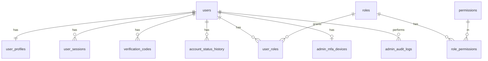
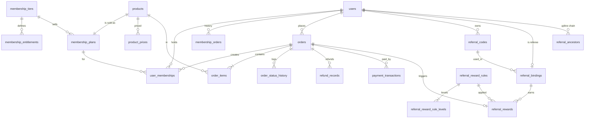
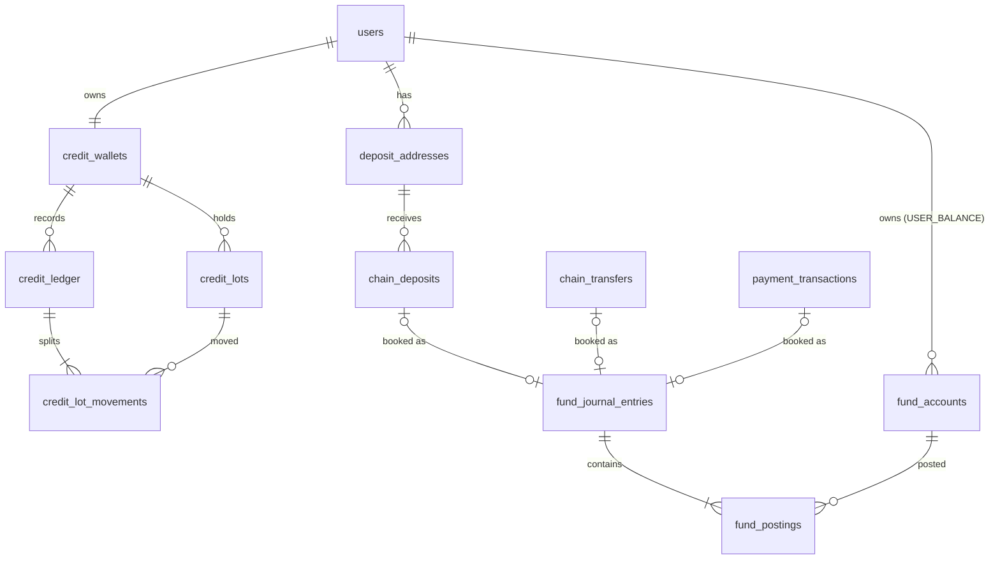

# 資料庫設計與 ERD

> PostgreSQL 16+。本文件以 PostgreSQL DDL 的寫法描述資料表，方便審閱；實際的 schema 由 Django migration 產生，
> 兩者必須一致。模組的歸屬與依賴規則見 `ARCHITECTURE.md` §5、§6；業務規則見 `BUSINESS-RULES.md`。

## 1. 共同規則

| 項目 | 規則 |
| --- | --- |
| 主鍵 | `id uuid`，由應用程式產生 UUIDv7 |
| 時間 | 一律 `timestamptz`，儲存 UTC；每張表都有 `created_at`，可變更的表有 `updated_at` |
| 現金金額 | `numeric(38,0)`，單位是該幣別的最小單位（USDT = 0.000001）；搭配 `currency varchar(10)` |
| 鏈上原始數量 | `numeric(78,0)`（可容納 uint256） |
| 點數 | `bigint` 整數 |
| 列舉值 | `text` + `CHECK`，不用 PostgreSQL enum（新增值時 migration 較簡單） |
| 外鍵 | 只能指向同模組或下層模組的表；往上層的引用只存 ID，欄位註明「無 FK」 |
| 樂觀鎖 | 會被併發修改的表有 `version bigint`，更新時 `WHERE version = :v` |
| 只能新增的表 | 以共用觸發器 `forbid_mutation()` 禁止 `UPDATE` / `DELETE`（§12） |
| 軟刪除 | 不使用；金融資料以反向記錄更正 |

## 2. ERD

### 2.1 身分、授權、稽核



### 2.2 會員、商務、推薦



### 2.3 點數錢包、資金帳本、鏈上



## 3. core

```sql
-- 交易內寫入的領域事件（ADR-07）
CREATE TABLE outbox_events (
  id              uuid PRIMARY KEY,
  event_type      text        NOT NULL,          -- 例：order.paid
  aggregate_type  text        NOT NULL,
  aggregate_id    uuid        NOT NULL,
  payload         jsonb       NOT NULL,
  correlation_id  uuid,
  occurred_at     timestamptz NOT NULL
);

-- 每個事件 × 每個訂閱者一列；訂閱者在自己的交易內把狀態改成 DONE，確保效果只生效一次
CREATE TABLE outbox_deliveries (
  event_id        uuid NOT NULL REFERENCES outbox_events(id),
  consumer        text NOT NULL,                 -- 例：referral.evaluate_reward
  status          text NOT NULL CHECK (status IN ('PENDING','DONE','DEAD')),
  attempts        int  NOT NULL DEFAULT 0,
  next_attempt_at timestamptz NOT NULL DEFAULT now(),
  last_error      text,
  done_at         timestamptz,
  PRIMARY KEY (event_id, consumer)
);
CREATE INDEX ON outbox_deliveries (next_attempt_at) WHERE status = 'PENDING';

-- API 層的 Idempotency-Key（保存 24 小時）
CREATE TABLE idempotency_keys (
  id              uuid PRIMARY KEY,
  user_id         uuid NOT NULL,                 -- 無 FK
  endpoint        text NOT NULL,
  key             text NOT NULL,
  request_hash    char(64) NOT NULL,             -- 同一個 key 但請求內容不同 → IDEMPOTENCY_KEY_REUSED
  response_status int,
  response_body   jsonb,
  created_at      timestamptz NOT NULL,
  expires_at      timestamptz NOT NULL,
  UNIQUE (user_id, endpoint, key)
);

-- 只存被後台修改過的值；預設值與型別在程式的設定註冊表（BUSINESS-RULES §10）
CREATE TABLE system_settings (
  key        text PRIMARY KEY,
  value      jsonb NOT NULL,
  version    bigint NOT NULL DEFAULT 1,
  updated_by uuid,                                -- 無 FK（core 在最底層）
  updated_at timestamptz NOT NULL
);

-- 點數、資金帳本、鏈上三種對帳的執行結果
CREATE TABLE reconciliation_runs (
  id          uuid PRIMARY KEY,
  kind        text NOT NULL CHECK (kind IN ('CREDITS','FUNDS_LEDGER','CHAIN')),
  scope       jsonb,                              -- 例：{"chain":"TRON","block":71234567}
  status      text NOT NULL CHECK (status IN ('RUNNING','PASSED','MISMATCH','ERROR')),
  summary     jsonb,
  mismatches  jsonb,
  started_at  timestamptz NOT NULL,
  finished_at timestamptz
);
```

## 4. identity

```sql
CREATE TABLE users (
  id                   uuid PRIMARY KEY,
  username             varchar(30)  NOT NULL,
  email                varchar(254),
  email_normalized     varchar(254),
  email_verified_at    timestamptz,
  phone_e164           varchar(16),
  phone_verified_at    timestamptz,
  password_hash        varchar(255) NOT NULL,     -- Argon2id
  status               text NOT NULL CHECK (status IN ('PENDING_VERIFICATION','ACTIVE','SUSPENDED','DISABLED')),
  is_staff             boolean NOT NULL DEFAULT false,
  signup_ip            inet,
  signup_device_hash   char(64),
  signup_referral_code varchar(20),               -- 註冊時輸入的推薦碼，驗證成功時使用
  activated_at         timestamptz,
  last_login_at        timestamptz,
  username_changed_at  timestamptz,
  created_at           timestamptz NOT NULL,
  updated_at           timestamptz NOT NULL,
  CHECK (email_normalized IS NOT NULL OR phone_e164 IS NOT NULL)
);
CREATE UNIQUE INDEX users_username_uq ON users (lower(username));
CREATE UNIQUE INDEX users_email_uq    ON users (email_normalized) WHERE email_normalized IS NOT NULL;
CREATE UNIQUE INDEX users_phone_uq    ON users (phone_e164)       WHERE phone_e164 IS NOT NULL;
CREATE INDEX ON users (status, created_at);     -- 清除過期的待驗證帳號

CREATE TABLE user_profiles (
  user_id    uuid PRIMARY KEY REFERENCES users(id) ON DELETE CASCADE,
  avatar_key text,                                -- 物件儲存的 key
  locale     varchar(10) NOT NULL DEFAULT 'zh-Hant',
  updated_at timestamptz NOT NULL
);

CREATE TABLE user_sessions (
  id                          uuid PRIMARY KEY,   -- 即 JWT 的 sid
  user_id                     uuid NOT NULL REFERENCES users(id) ON DELETE CASCADE,
  audience                    text NOT NULL CHECK (audience IN ('MEMBER','ADMIN')),
  client_type                 text NOT NULL CHECK (client_type IN ('WEB','APP')),
  refresh_token_hash          char(64) NOT NULL UNIQUE,
  previous_refresh_token_hash char(64),           -- 用來偵測舊 token 重放
  rotation_count              int NOT NULL DEFAULT 0,
  mfa_verified_at             timestamptz,        -- 後台 session
  device_label                text,
  ip                          inet,
  user_agent                  text,
  created_at                  timestamptz NOT NULL,
  last_used_at                timestamptz NOT NULL,
  idle_expires_at             timestamptz NOT NULL,
  absolute_expires_at         timestamptz NOT NULL,
  revoked_at                  timestamptz,
  revoke_reason               text CHECK (revoke_reason IN
    ('LOGOUT','LOGOUT_ALL','PASSWORD_CHANGED','ACCOUNT_SUSPENDED','REUSE_DETECTED','ADMIN_REVOKED'))
);
CREATE INDEX ON user_sessions (user_id) WHERE revoked_at IS NULL;
CREATE INDEX ON user_sessions (previous_refresh_token_hash);

CREATE TABLE verification_codes (
  id           uuid PRIMARY KEY,
  purpose      text NOT NULL CHECK (purpose IN ('REGISTER','PASSWORD_RESET','CHANGE_EMAIL','CHANGE_PHONE')),
  channel      text NOT NULL CHECK (channel IN ('EMAIL','SMS')),
  target       varchar(254) NOT NULL,             -- 正規化後的 email 或 E.164 手機號
  user_id      uuid REFERENCES users(id) ON DELETE CASCADE,
  code_hash    char(64) NOT NULL,                 -- HMAC-SHA256(伺服器密鑰, id || code)
  attempts     int NOT NULL DEFAULT 0,
  max_attempts int NOT NULL,
  expires_at   timestamptz NOT NULL,
  consumed_at  timestamptz,
  created_ip   inet,
  created_at   timestamptz NOT NULL
);
CREATE INDEX ON verification_codes (target, purpose, created_at DESC);

CREATE TABLE account_status_history (            -- 只能新增
  id          uuid PRIMARY KEY,
  user_id     uuid NOT NULL REFERENCES users(id),
  from_status text NOT NULL,
  to_status   text NOT NULL,
  reason      text,
  actor_type  text NOT NULL CHECK (actor_type IN ('USER','ADMIN','SYSTEM')),
  actor_id    uuid,
  created_at  timestamptz NOT NULL
);

CREATE TABLE security_events (                   -- 只能新增
  id              uuid PRIMARY KEY,
  user_id         uuid,                           -- 無 FK：待驗證帳號會被刪除，事件仍保留
  identifier_hash char(64),                       -- 登入失敗時的識別值雜湊（帳號可能不存在）
  event_type      text NOT NULL,                  -- LOGIN_SUCCESS、LOGIN_FAILED、LOCKED、REFRESH_REUSE、PASSWORD_CHANGED……
  ip              inet,
  user_agent      text,
  metadata        jsonb,
  created_at      timestamptz NOT NULL
);
CREATE INDEX ON security_events (user_id, created_at DESC);
CREATE INDEX ON security_events (event_type, created_at DESC);
```

## 5. access

```sql
CREATE TABLE roles (
  id          uuid PRIMARY KEY,
  code        varchar(50) NOT NULL UNIQUE,        -- SUPER_ADMIN、FINANCE_ADMIN、MEMBER_SUPPORT、OPERATIONS_ADMIN、CREATOR
  name        varchar(100) NOT NULL,
  description text,
  scope       text NOT NULL CHECK (scope IN ('ADMIN','MEMBER')),
  is_system   boolean NOT NULL DEFAULT false,     -- 內建角色不可刪除
  created_at  timestamptz NOT NULL,
  updated_at  timestamptz NOT NULL
);

CREATE TABLE permissions (                       -- 由程式宣告，部署時同步
  code        varchar(80) PRIMARY KEY,            -- 例：refund.manage
  module      varchar(40) NOT NULL,
  scope       text NOT NULL CHECK (scope IN ('ADMIN','MEMBER')),
  description text NOT NULL
);

CREATE TABLE user_roles (
  user_id    uuid NOT NULL REFERENCES users(id),
  role_id    uuid NOT NULL REFERENCES roles(id),
  granted_by uuid REFERENCES users(id),
  granted_at timestamptz NOT NULL,
  PRIMARY KEY (user_id, role_id)
);
-- 服務層檢查：ADMIN 角色只能指派給 is_staff = true 的帳號；不可移除最後一位 SUPER_ADMIN

CREATE TABLE role_permissions (
  role_id         uuid NOT NULL REFERENCES roles(id) ON DELETE CASCADE,
  permission_code varchar(80) NOT NULL REFERENCES permissions(code),
  PRIMARY KEY (role_id, permission_code)
);

CREATE TABLE admin_mfa_devices (
  id                    uuid PRIMARY KEY,
  user_id               uuid NOT NULL UNIQUE REFERENCES users(id),
  secret_encrypted      bytea NOT NULL,           -- 以 FIELD_ENCRYPTION_KEY 加密
  confirmed_at          timestamptz,
  last_used_step        bigint,                   -- 防止同一組 TOTP 重複使用
  recovery_code_hashes  text[] NOT NULL DEFAULT '{}',
  created_at            timestamptz NOT NULL,
  updated_at            timestamptz NOT NULL
);
```

## 6. audit、notifications、reporting

```sql
CREATE TABLE admin_audit_logs (                  -- 只能新增；與業務異動同一交易寫入
  id          uuid PRIMARY KEY,
  actor_id    uuid NOT NULL REFERENCES users(id),
  session_id  uuid,
  actor_ip    inet,
  action      varchar(80) NOT NULL,               -- 與權限代碼同名，例：wallet.adjust
  target_type varchar(50) NOT NULL,
  target_id   text NOT NULL,
  before      jsonb,
  after       jsonb,
  reason      text,
  reference   text,                               -- 客服工單號等
  request_id  uuid,
  created_at  timestamptz NOT NULL
);
CREATE INDEX ON admin_audit_logs (actor_id, created_at DESC);
CREATE INDEX ON admin_audit_logs (target_type, target_id, created_at DESC);
CREATE INDEX ON admin_audit_logs (action, created_at DESC);

CREATE TABLE notification_logs (                 -- 不保存驗證碼或內文
  id                  uuid PRIMARY KEY,
  user_id             uuid,                       -- 無 FK
  channel             text NOT NULL CHECK (channel IN ('EMAIL','SMS')),
  template            varchar(80) NOT NULL,
  target_masked       varchar(64) NOT NULL,
  status              text NOT NULL CHECK (status IN ('QUEUED','SENT','FAILED')),
  provider_message_id text,
  error               text,
  created_at          timestamptz NOT NULL,
  sent_at             timestamptz
);

CREATE TABLE export_jobs (
  id           uuid PRIMARY KEY,
  requested_by uuid NOT NULL REFERENCES users(id),
  export_type  text NOT NULL CHECK (export_type IN ('ORDERS','CREDIT_TRANSACTIONS','FUND_ENTRIES')),
  filters      jsonb NOT NULL,
  status       text NOT NULL CHECK (status IN ('QUEUED','RUNNING','SUCCEEDED','FAILED','EXPIRED')),
  file_key     text,
  row_count    int,
  error        text,
  created_at   timestamptz NOT NULL,
  finished_at  timestamptz,
  expires_at   timestamptz
);
```

## 7. wallet（AI 點數）

演算法與帳目類型見 `WALLET-LEDGER.md` 第一部分。

```sql
CREATE TABLE credit_wallets (
  id         uuid PRIMARY KEY,
  user_id    uuid NOT NULL UNIQUE REFERENCES users(id),
  balance    bigint NOT NULL DEFAULT 0 CHECK (balance >= 0),
  version    bigint NOT NULL DEFAULT 0,
  created_at timestamptz NOT NULL,
  updated_at timestamptz NOT NULL
);

CREATE TABLE credit_lots (
  id               uuid PRIMARY KEY,
  wallet_id        uuid NOT NULL REFERENCES credit_wallets(id),
  credit_type      text NOT NULL CHECK (credit_type IN ('PURCHASED','PROMOTIONAL','MEMBERSHIP','ADMIN')),
  source_type      text NOT NULL CHECK (source_type IN ('ORDER','MEMBERSHIP_CYCLE','PROMOTION','ADMIN_ADJUSTMENT','REVERSAL')),
  source_ref       text NOT NULL,                  -- 訂單 ID、會員週期鍵、活動代碼等
  original_amount  bigint NOT NULL CHECK (original_amount > 0),
  remaining_amount bigint NOT NULL,
  expires_at       timestamptz,                    -- NULL = 不過期
  status           text NOT NULL CHECK (status IN ('ACTIVE','DEPLETED','EXPIRED','REVOKED')),
  created_at       timestamptz NOT NULL,
  updated_at       timestamptz NOT NULL,
  CHECK (remaining_amount BETWEEN 0 AND original_amount)
);
CREATE INDEX ON credit_lots (wallet_id, status, expires_at);
CREATE INDEX ON credit_lots (expires_at) WHERE status = 'ACTIVE' AND expires_at IS NOT NULL;

CREATE TABLE credit_ledger (                      -- 只能新增
  id                uuid PRIMARY KEY,             -- 即 spec 的 Transaction ID
  wallet_id         uuid NOT NULL REFERENCES credit_wallets(id),
  user_id           uuid NOT NULL REFERENCES users(id),
  entry_type        text NOT NULL CHECK (entry_type IN
    ('GRANT','CONSUME','CONSUME_REVERSAL','EXPIRE','REVOKE','ADJUST_IN','ADJUST_OUT')),
  credit_type       text,                         -- 只涉及單一類型時填寫
  amount            bigint NOT NULL CHECK (amount <> 0),
  balance_before    bigint NOT NULL,
  balance_after     bigint NOT NULL CHECK (balance_after >= 0),
  order_id          uuid,                         -- 無 FK（wallet 不依賴 commerce）
  generation_job_id uuid,                         -- 無 FK，未來 AI Studio 使用
  reversal_of_id    uuid REFERENCES credit_ledger(id),
  expires_at        timestamptz,                  -- GRANT 時的批次到期時間
  idempotency_key   text NOT NULL,
  actor_type        text NOT NULL CHECK (actor_type IN ('USER','ADMIN','SYSTEM')),
  actor_id          uuid,
  reason            text,
  reference         text,
  created_at        timestamptz NOT NULL,
  CHECK (balance_after = balance_before + amount),
  UNIQUE (wallet_id, idempotency_key)
);
CREATE INDEX ON credit_ledger (wallet_id, created_at DESC);
CREATE INDEX ON credit_ledger (order_id) WHERE order_id IS NOT NULL;
CREATE INDEX ON credit_ledger (reversal_of_id) WHERE reversal_of_id IS NOT NULL;

CREATE TABLE credit_lot_movements (               -- 只能新增
  id         uuid PRIMARY KEY,
  ledger_id  uuid NOT NULL REFERENCES credit_ledger(id),
  lot_id     uuid NOT NULL REFERENCES credit_lots(id),
  amount     bigint NOT NULL CHECK (amount <> 0), -- 正數：批次增加；負數：批次減少
  created_at timestamptz NOT NULL
);
CREATE INDEX ON credit_lot_movements (ledger_id);
CREATE INDEX ON credit_lot_movements (lot_id);
```

## 8. funds（USDT 資金帳本）

帳戶表與分錄範本見 `WALLET-LEDGER.md` 第二部分。

```sql
CREATE TABLE fund_accounts (
  id           uuid PRIMARY KEY,
  category     text NOT NULL CHECK (category IN
    ('USER_BALANCE','DEPOSIT_POOL','HOT_WALLET','COLD_WALLET','STAKED',
     'SALES_REVENUE','SALES_REFUNDS','NETWORK_FEE','SUSPENSE','PLATFORM_CAPITAL')),
  account_type text NOT NULL CHECK (account_type IN ('ASSET','LIABILITY','EQUITY','REVENUE','EXPENSE')),
  normal_side  text NOT NULL CHECK (normal_side IN ('DEBIT','CREDIT')),
  currency     varchar(10) NOT NULL,              -- USDT、TRX、BNB
  chain        varchar(10),                       -- 鏈上資產帳戶必填：TRON、BSC
  user_id      uuid REFERENCES users(id),         -- 只有 USER_BALANCE 有值
  balance      numeric(38,0) NOT NULL DEFAULT 0,  -- 以帳戶的正常方向表示
  version      bigint NOT NULL DEFAULT 0,
  created_at   timestamptz NOT NULL,
  updated_at   timestamptz NOT NULL,
  CHECK (category <> 'USER_BALANCE' OR (user_id IS NOT NULL AND balance >= 0)),
  UNIQUE NULLS NOT DISTINCT (category, currency, chain, user_id)
);

CREATE TABLE fund_journal_entries (               -- 只能新增
  id              uuid PRIMARY KEY,
  entry_type      text NOT NULL CHECK (entry_type IN
    ('DEPOSIT','DEPOSIT_TO_SUSPENSE','SUSPENSE_RESOLVE','PAYMENT','REFUND','SWEEP','GAS_TOPUP',
     'NETWORK_FEE','CAPITAL_IN','CAPITAL_OUT','ADJUSTMENT')),
  reference_type  text NOT NULL,                  -- chain_deposit、payment、refund、chain_transfer……
  reference_id    uuid NOT NULL,
  idempotency_key text NOT NULL UNIQUE,
  description     text,
  actor_type      text NOT NULL CHECK (actor_type IN ('USER','ADMIN','SYSTEM')),
  actor_id        uuid,
  created_at      timestamptz NOT NULL
);
CREATE INDEX ON fund_journal_entries (reference_type, reference_id);

CREATE TABLE fund_postings (                      -- 只能新增
  id         uuid PRIMARY KEY,
  entry_id   uuid NOT NULL REFERENCES fund_journal_entries(id),
  account_id uuid NOT NULL REFERENCES fund_accounts(id),
  direction  text NOT NULL CHECK (direction IN ('DEBIT','CREDIT')),
  amount     numeric(38,0) NOT NULL CHECK (amount > 0),
  currency   varchar(10) NOT NULL,              -- 必須等於帳戶幣別（觸發器檢查）
  created_at timestamptz NOT NULL
);
CREATE INDEX ON fund_postings (account_id, created_at DESC);
CREATE INDEX ON fund_postings (entry_id);
-- 延遲約束觸發器 assert_entry_balanced()：交易提交時，每筆分錄的每個幣別借方合計 = 貸方合計
```

## 9. commerce

```sql
CREATE TABLE products (
  id            uuid PRIMARY KEY,
  sku           varchar(50) NOT NULL UNIQUE,
  product_type  text NOT NULL CHECK (product_type IN ('MEMBERSHIP_PLAN','CREDIT_PACK','AI_SERVICE')),
  name          varchar(100) NOT NULL,
  description   text,
  currency      varchar(10) NOT NULL DEFAULT 'USDT',
  status        text NOT NULL CHECK (status IN ('ACTIVE','INACTIVE')),
  attributes    jsonb NOT NULL DEFAULT '{}',      -- CREDIT_PACK：{"credits": 1000}
  display_order int NOT NULL DEFAULT 0,
  created_at    timestamptz NOT NULL,
  updated_at    timestamptz NOT NULL
);

-- 價格歷史；目前價格 = effective_from ≤ now 的最新一筆。已生效的列不可修改或刪除（觸發器）
CREATE TABLE product_prices (
  id             uuid PRIMARY KEY,
  product_id     uuid NOT NULL REFERENCES products(id),
  amount         numeric(38,0) NOT NULL CHECK (amount > 0),
  currency       varchar(10) NOT NULL,
  effective_from timestamptz NOT NULL,
  created_by     uuid REFERENCES users(id),
  created_at     timestamptz NOT NULL,
  UNIQUE (product_id, effective_from)
);

CREATE TABLE orders (
  id                     uuid PRIMARY KEY,
  order_number           varchar(20) NOT NULL UNIQUE,     -- PL20261126-7K3QX9
  user_id                uuid NOT NULL REFERENCES users(id),
  order_type             text NOT NULL CHECK (order_type IN
    ('MEMBERSHIP_PURCHASE','MEMBERSHIP_RENEWAL','MEMBERSHIP_AUTO_RENEWAL','MEMBERSHIP_UPGRADE','CREDIT_PURCHASE','AI_SERVICE')),
  status                 text NOT NULL CHECK (status IN
    ('CREATED','PENDING_PAYMENT','PAID','PROCESSING','COMPLETED','CANCELLED','EXPIRED',
     'REFUND_PENDING','REFUNDED','FAILED')),
  currency               varchar(10) NOT NULL,
  subtotal_amount        numeric(38,0) NOT NULL CHECK (subtotal_amount >= 0),
  discount_amount        numeric(38,0) NOT NULL DEFAULT 0 CHECK (discount_amount >= 0),  -- 升級的抵扣額
  total_amount           numeric(38,0) NOT NULL CHECK (total_amount > 0),
  paid_amount            numeric(38,0) NOT NULL DEFAULT 0,
  refunded_amount        numeric(38,0) NOT NULL DEFAULT 0,
  payment_method         text CHECK (payment_method IN ('USDT_BALANCE')),
  payment_status         text NOT NULL CHECK (payment_status IN ('UNPAID','PAID','PARTIALLY_REFUNDED','REFUNDED')),
  pricing_snapshot       jsonb,                    -- 升級計算過程、價格版本
  expires_at             timestamptz NOT NULL,
  paid_at                timestamptz,
  completed_at           timestamptz,
  cancelled_at           timestamptz,
  refunded_at            timestamptz,
  fulfillment_attempts   int NOT NULL DEFAULT 0,
  last_fulfillment_error text,
  version                bigint NOT NULL DEFAULT 0,
  created_at             timestamptz NOT NULL,
  updated_at             timestamptz NOT NULL,
  CHECK (total_amount = subtotal_amount - discount_amount),
  CHECK (refunded_amount <= paid_amount)
);
CREATE INDEX ON orders (user_id, created_at DESC);
CREATE INDEX ON orders (expires_at) WHERE status IN ('CREATED','PENDING_PAYMENT');
CREATE INDEX ON orders (status, updated_at) WHERE status IN ('PAID','PROCESSING','FAILED','REFUND_PENDING');

CREATE TABLE order_items (
  id                  uuid PRIMARY KEY,
  order_id            uuid NOT NULL REFERENCES orders(id),
  product_id          uuid NOT NULL REFERENCES products(id),
  product_type        text NOT NULL,
  product_name        varchar(100) NOT NULL,       -- 快照
  quantity            int NOT NULL CHECK (quantity > 0),
  unit_price          numeric(38,0) NOT NULL,
  total_price         numeric(38,0) NOT NULL,
  attributes_snapshot jsonb NOT NULL,
  created_at          timestamptz NOT NULL,
  CHECK (total_price = unit_price * quantity)
);
CREATE UNIQUE INDEX ON order_items (order_id);   -- 本期每張訂單只有一個品項；取消此限制時刪除這個索引

CREATE TABLE order_status_history (               -- 只能新增
  id          uuid PRIMARY KEY,
  order_id    uuid NOT NULL REFERENCES orders(id),
  from_status text,
  to_status   text NOT NULL,
  reason      text,
  actor_type  text NOT NULL CHECK (actor_type IN ('USER','ADMIN','SYSTEM')),
  actor_id    uuid,
  created_at  timestamptz NOT NULL
);
CREATE INDEX ON order_status_history (order_id, created_at);

-- 退款一律退回站內 USDT 餘額，不經過鏈上（D-18）；資金分錄由 payment_transactions(kind = 'REFUND') 連結
CREATE TABLE refund_records (
  id           uuid PRIMARY KEY,
  order_id     uuid NOT NULL REFERENCES orders(id),
  amount       numeric(38,0) NOT NULL CHECK (amount > 0),
  currency     varchar(10) NOT NULL,
  method       text NOT NULL CHECK (method IN ('USDT_BALANCE')),
  status       text NOT NULL CHECK (status IN ('PENDING','COMPLETED','FAILED')),
                                                 -- 本期同步完成，只會出現 COMPLETED；其他值保留給未來的支付方式
  reason       text NOT NULL,
  reference    text NOT NULL,                    -- 客服工單號等
  created_by   uuid NOT NULL REFERENCES users(id),
  completed_at timestamptz,
  created_at   timestamptz NOT NULL
);
CREATE UNIQUE INDEX ON refund_records (order_id) WHERE status <> 'FAILED';   -- 本期每張訂單只能退款一次
```

## 10. payments、chain

```sql
CREATE TABLE payment_transactions (               -- 只能新增
  id                uuid PRIMARY KEY,
  order_id          uuid NOT NULL REFERENCES orders(id),
  user_id           uuid NOT NULL REFERENCES users(id),
  kind              text NOT NULL CHECK (kind IN ('PAYMENT','REFUND')),
  method            text NOT NULL CHECK (method IN ('USDT_BALANCE')),
  amount            numeric(38,0) NOT NULL CHECK (amount > 0),
  currency          varchar(10) NOT NULL,
  status            text NOT NULL CHECK (status IN ('SUCCEEDED','FAILED')),
  failure_code      text,                         -- 例：INSUFFICIENT_BALANCE
  journal_entry_id  uuid REFERENCES fund_journal_entries(id),
  refund_id         uuid REFERENCES refund_records(id),
  created_at        timestamptz NOT NULL
);
CREATE UNIQUE INDEX ON payment_transactions (order_id) WHERE kind = 'PAYMENT' AND status = 'SUCCEEDED';

CREATE TABLE deposit_addresses (
  id               uuid PRIMARY KEY,
  user_id          uuid NOT NULL REFERENCES users(id),
  chain            text NOT NULL CHECK (chain IN ('TRON','BSC')),
  address          varchar(64) NOT NULL,          -- TRON：Base58（T 開頭）；BSC：EIP-55 校驗格式
  derivation_index int NOT NULL,                  -- 內部序號，不對外
  status           text NOT NULL CHECK (status IN ('ACTIVE','RETIRED')),
  created_at       timestamptz NOT NULL,
  UNIQUE (chain, address),
  UNIQUE (chain, derivation_index)
);
CREATE UNIQUE INDEX ON deposit_addresses (chain, user_id) WHERE status = 'ACTIVE';

CREATE TABLE treasury_wallets (
  id             uuid PRIMARY KEY,
  chain          text NOT NULL CHECK (chain IN ('TRON','BSC')),
  kind           text NOT NULL CHECK (kind IN ('HOT','COLD','STAKING')),
  address        varchar(64) NOT NULL,
  label          varchar(100) NOT NULL,
  signer_key_ref text,                            -- HOT、STAKING：簽章服務內的金鑰代號
  status         text NOT NULL CHECK (status IN ('ACTIVE','RETIRED')),
  created_by     uuid REFERENCES users(id),
  created_at     timestamptz NOT NULL,
  UNIQUE (chain, address)
);
CREATE UNIQUE INDEX ON treasury_wallets (chain, kind) WHERE status = 'ACTIVE' AND kind IN ('HOT','STAKING');

CREATE TABLE chain_scan_cursors (
  chain                 text PRIMARY KEY,
  token_contract        varchar(64) NOT NULL,
  last_scanned_block    bigint NOT NULL,
  last_scanned_hash     varchar(80),
  last_finalized_block  bigint,
  updated_at            timestamptz NOT NULL
);

CREATE TABLE chain_deposits (
  id                 uuid PRIMARY KEY,
  chain              text NOT NULL,
  tx_hash            varchar(80) NOT NULL,
  log_index          int NOT NULL,
  block_number       bigint NOT NULL,
  block_hash         varchar(80) NOT NULL,
  token_contract     varchar(64) NOT NULL,
  from_address       varchar(64) NOT NULL,
  to_address         varchar(64) NOT NULL,
  deposit_address_id uuid REFERENCES deposit_addresses(id),
  user_id            uuid REFERENCES users(id),
  raw_amount         numeric(78,0) NOT NULL CHECK (raw_amount > 0),
  amount             numeric(38,0) NOT NULL,        -- 站內 6 位小數
  truncated_raw      numeric(78,0) NOT NULL DEFAULT 0,  -- BEP-20 換算時捨去的部分
  confirmations      int NOT NULL DEFAULT 0,
  status             text NOT NULL CHECK (status IN ('DETECTED','CONFIRMED','DROPPED','HELD','RESOLVED')),
  hold_reason        text CHECK (hold_reason IN ('RISK_HIT','MANUAL_REVIEW')),
  second_source_ok   boolean,                        -- 大額入金的第二來源確認結果
  journal_entry_id   uuid REFERENCES fund_journal_entries(id),
  resolution         text CHECK (resolution IN ('CREDITED_TO_USER','WRITTEN_OFF')),   -- 不在鏈上退回
  resolved_by        uuid REFERENCES users(id),
  resolution_approved_by uuid REFERENCES users(id),  -- 沖銷需第二位管理員核准
  resolved_at        timestamptz,
  detected_at        timestamptz NOT NULL,
  confirmed_at       timestamptz,
  created_at         timestamptz NOT NULL,
  updated_at         timestamptz NOT NULL,
  CHECK (resolution_approved_by IS NULL OR resolution_approved_by <> resolved_by),
  UNIQUE (chain, tx_hash, log_index)
);
CREATE INDEX ON chain_deposits (chain, status) WHERE status IN ('DETECTED','HELD');
CREATE INDEX ON chain_deposits (user_id, created_at DESC);

CREATE TABLE chain_transfers (
  id              uuid PRIMARY KEY,
  chain           text NOT NULL CHECK (chain IN ('TRON','BSC')),
  purpose         text NOT NULL CHECK (purpose IN
    ('SWEEP','GAS_TOPUP','ENERGY_DELEGATION','CAPITAL_IN','CAPITAL_OUT')),   -- 未來出金模組再加 WITHDRAWAL 等
  asset           text NOT NULL CHECK (asset IN ('USDT','TRX','BNB')),
  from_address    varchar(64) NOT NULL,
  to_address      varchar(64) NOT NULL,
  amount          numeric(38,0) NOT NULL CHECK (amount > 0),
  raw_amount      numeric(78,0) NOT NULL,
  status          text NOT NULL CHECK (status IN
    ('CREATED','SIGNING','SIGNED','BROADCAST','CONFIRMED','FAILED','CANCELLED')),
  reference_type  text,                            -- deposit_address 等
  reference_id    uuid,
  nonce           bigint,                          -- BSC
  sign_request_id uuid,
  signed_payload  bytea,                           -- 已簽交易，可重新廣播
  tx_hash         varchar(80),
  block_number    bigint,
  confirmations   int NOT NULL DEFAULT 0,
  fee_asset       text,
  fee_amount      numeric(38,0),
  error           text,
  created_by_type text NOT NULL CHECK (created_by_type IN ('ADMIN','SYSTEM')),
  created_by_id   uuid,
  approved_by     uuid REFERENCES users(id),       -- CAPITAL_OUT 需第二位管理員核准
  broadcast_at    timestamptz,
  confirmed_at    timestamptz,
  created_at      timestamptz NOT NULL,
  updated_at      timestamptz NOT NULL,
  CHECK (approved_by IS NULL OR approved_by <> created_by_id)
);
CREATE UNIQUE INDEX ON chain_transfers (chain, tx_hash) WHERE tx_hash IS NOT NULL;
CREATE UNIQUE INDEX ON chain_transfers (reference_type, reference_id, purpose)
  WHERE reference_id IS NOT NULL AND status NOT IN ('FAILED','CANCELLED');
CREATE INDEX ON chain_transfers (status, chain) WHERE status IN ('CREATED','SIGNING','SIGNED','BROADCAST');
```

## 11. membership、referral

```sql
CREATE TABLE membership_tiers (
  id               uuid PRIMARY KEY,
  code             varchar(30) NOT NULL UNIQUE,   -- FREE、STANDARD、VIP、CREATOR
  name             varchar(50) NOT NULL,
  description      text,
  benefits         jsonb NOT NULL DEFAULT '[]',   -- 顯示用的權益說明
  rank             int NOT NULL UNIQUE,
  display_priority int NOT NULL DEFAULT 0,
  status           text NOT NULL CHECK (status IN ('ACTIVE','INACTIVE')),
  is_default       boolean NOT NULL DEFAULT false,
  created_at       timestamptz NOT NULL,
  updated_at       timestamptz NOT NULL,
  CHECK (NOT is_default OR status = 'ACTIVE')
);
CREATE UNIQUE INDEX ON membership_tiers (is_default) WHERE is_default;

CREATE TABLE membership_entitlements (
  tier_id    uuid NOT NULL REFERENCES membership_tiers(id),
  key        varchar(80) NOT NULL,                -- 例：ai.credits.per_cycle
  value      jsonb NOT NULL,                      -- 型別由程式的權益註冊表驗證
  updated_by uuid REFERENCES users(id),
  updated_at timestamptz NOT NULL,
  PRIMARY KEY (tier_id, key)
);

CREATE TABLE membership_plans (
  id              uuid PRIMARY KEY,
  tier_id         uuid NOT NULL REFERENCES membership_tiers(id),
  billing_period  text NOT NULL CHECK (billing_period IN ('MONTHLY','ANNUAL')),
  duration_months int  NOT NULL CHECK (duration_months IN (1, 12)),
  product_id      uuid NOT NULL UNIQUE REFERENCES products(id),
  status          text NOT NULL CHECK (status IN ('ACTIVE','INACTIVE')),
  created_at      timestamptz NOT NULL,
  updated_at      timestamptz NOT NULL,
  UNIQUE (tier_id, billing_period)
);

CREATE TABLE user_memberships (
  id                     uuid PRIMARY KEY,
  user_id                uuid NOT NULL REFERENCES users(id),
  tier_id                uuid NOT NULL REFERENCES membership_tiers(id),
  plan_id                uuid NOT NULL REFERENCES membership_plans(id),
  status                 text NOT NULL CHECK (status IN
    ('SCHEDULED','ACTIVE','GRACE','EXPIRED','SUPERSEDED','REVOKED')),
  starts_at              timestamptz NOT NULL,
  ends_at                timestamptz NOT NULL,
  grace_ends_at          timestamptz,
  period_value           numeric(38,0) NOT NULL,  -- 升級折算用（BUSINESS-RULES §2.4）
  currency               varchar(10) NOT NULL,
  auto_renew             boolean NOT NULL DEFAULT false,
  next_plan_id           uuid REFERENCES membership_plans(id),  -- 排定的降級
  source_order_id        uuid NOT NULL REFERENCES orders(id),
  previous_membership_id uuid REFERENCES user_memberships(id),
  cycles_granted         int NOT NULL DEFAULT 0,
  version                bigint NOT NULL DEFAULT 0,
  created_at             timestamptz NOT NULL,
  updated_at             timestamptz NOT NULL,
  CHECK (ends_at > starts_at),
  EXCLUDE USING gist (user_id WITH =, tstzrange(starts_at, ends_at) WITH &&)
    WHERE (status IN ('SCHEDULED','ACTIVE','GRACE'))
);
CREATE INDEX ON user_memberships (user_id, status);
CREATE INDEX ON user_memberships (ends_at) WHERE status IN ('ACTIVE','GRACE');

-- spec 的表名是 membership_orders；實際用途是「會員異動歷史」（REQ-049）
CREATE TABLE membership_orders (                  -- 只能新增
  id            uuid PRIMARY KEY,
  user_id       uuid NOT NULL REFERENCES users(id),
  action        text NOT NULL CHECK (action IN
    ('PURCHASE','RENEW','AUTO_RENEW','UPGRADE','DOWNGRADE_SCHEDULED','DOWNGRADE_CANCELLED',
     'SCHEDULED_ACTIVATED','GRACE_STARTED','EXPIRED','REVOKED','AUTO_RENEW_ON','AUTO_RENEW_OFF')),
  order_id      uuid REFERENCES orders(id),
  membership_id uuid REFERENCES user_memberships(id),
  from_tier_id  uuid REFERENCES membership_tiers(id),
  to_tier_id    uuid REFERENCES membership_tiers(id),
  amount        numeric(38,0),
  currency      varchar(10),
  effective_at  timestamptz NOT NULL,
  actor_type    text NOT NULL CHECK (actor_type IN ('USER','ADMIN','SYSTEM')),
  actor_id      uuid,
  note          text,
  created_at    timestamptz NOT NULL
);
CREATE INDEX ON membership_orders (user_id, created_at DESC);

CREATE TABLE referral_codes (
  id            uuid PRIMARY KEY,
  user_id       uuid NOT NULL REFERENCES users(id),
  code          varchar(20) NOT NULL UNIQUE,       -- 已正規化（大寫）
  status        text NOT NULL CHECK (status IN ('ACTIVE','INACTIVE','SUSPENDED')),
  status_reason text,
  created_at    timestamptz NOT NULL,
  updated_at    timestamptz NOT NULL
);
CREATE UNIQUE INDEX ON referral_codes (user_id) WHERE status IN ('ACTIVE','SUSPENDED');

CREATE TABLE referral_link_visits (
  id                uuid PRIMARY KEY,
  referral_code_id  uuid NOT NULL REFERENCES referral_codes(id),
  visitor_id_hash   char(64) NOT NULL,             -- 前端匿名 cookie ID 的雜湊
  ip_hash           char(64),
  first_seen_at     timestamptz NOT NULL,
  UNIQUE (referral_code_id, visitor_id_hash)
);

CREATE TABLE referral_bindings (                  -- 只能新增
  id                 uuid PRIMARY KEY,
  referee_id         uuid NOT NULL UNIQUE REFERENCES users(id),   -- 每人只能有一位推薦人
  referrer_id        uuid NOT NULL REFERENCES users(id),
  referral_code_id   uuid NOT NULL REFERENCES referral_codes(id),
  code_snapshot      varchar(20) NOT NULL,
  referee_signup_ip  inet,
  referee_device_hash char(64),
  bound_at           timestamptz NOT NULL,
  CHECK (referee_id <> referrer_id)
);
CREATE INDEX ON referral_bindings (referrer_id, bound_at DESC);

-- 上線鏈：綁定時在同一交易寫入，只能新增（REFERRAL-FLOW §4.3）
CREATE TABLE referral_ancestors (
  user_id     uuid NOT NULL REFERENCES users(id),                  -- 下線
  depth       smallint NOT NULL CHECK (depth BETWEEN 1 AND 10),    -- 1 = 直接推薦人
  ancestor_id uuid NOT NULL REFERENCES users(id),                  -- 第 depth 層上線
  created_at  timestamptz NOT NULL,
  PRIMARY KEY (user_id, depth),
  UNIQUE (user_id, ancestor_id),
  CHECK (user_id <> ancestor_id)
);
CREATE INDEX ON referral_ancestors (ancestor_id, depth);

CREATE TABLE referral_bind_attempts (
  id         uuid PRIMARY KEY,
  referee_id uuid NOT NULL REFERENCES users(id),
  code_input varchar(40) NOT NULL,
  result     text NOT NULL CHECK (result IN
    ('BOUND','CODE_INVALID','REFERRER_INELIGIBLE','SELF_REFERRAL','ALREADY_BOUND','CIRCULAR')),
  created_at timestamptz NOT NULL
);

-- 儀表板「付費數」用；由 order.completed 事件更新
CREATE TABLE referral_referee_activity (
  referee_id          uuid PRIMARY KEY REFERENCES users(id),
  referrer_id         uuid NOT NULL REFERENCES users(id),
  first_paid_order_id uuid NOT NULL REFERENCES orders(id),
  first_paid_at       timestamptz NOT NULL,
  completed_orders    int NOT NULL DEFAULT 1,
  updated_at          timestamptz NOT NULL
);
CREATE INDEX ON referral_referee_activity (referrer_id);

CREATE TABLE referral_reward_rules (
  id                     uuid PRIMARY KEY,
  name                   varchar(100) NOT NULL,
  status                 text NOT NULL CHECK (status IN ('ACTIVE','INACTIVE')),
  priority               int NOT NULL,              -- 數字大者優先
  currency               varchar(10) NOT NULL DEFAULT 'USDT',
  min_order_amount       numeric(38,0) NOT NULL DEFAULT 0,
  eligible_product_types text[] NOT NULL,
  campaign_code          varchar(50),
  starts_at              timestamptz,
  ends_at                timestamptz,
  settlement_delay_days  int NOT NULL CHECK (settlement_delay_days >= 0),
  first_purchase_only    boolean NOT NULL DEFAULT false,
  max_rewards_per_referee int,
  created_by             uuid NOT NULL REFERENCES users(id),
  created_at             timestamptz NOT NULL,
  updated_at             timestamptz NOT NULL
);

-- 每一層的獎勵；「層級從 1 開始連續」與「各層 percent_bps 合計 ≤ 10000」由服務層在存檔時檢查
CREATE TABLE referral_reward_rule_levels (
  rule_id           uuid NOT NULL REFERENCES referral_reward_rules(id),
  level             smallint NOT NULL CHECK (level BETWEEN 1 AND 10),   -- 1 = 直接推薦人
  reward_type       text NOT NULL CHECK (reward_type IN ('FIXED','PERCENT')),
  fixed_amount      numeric(38,0),
  percent_bps       int CHECK (percent_bps BETWEEN 1 AND 10000),        -- 1000 = 10%
  max_reward_amount numeric(38,0) CHECK (max_reward_amount > 0),
  created_at        timestamptz NOT NULL,
  updated_at        timestamptz NOT NULL,
  PRIMARY KEY (rule_id, level),
  CHECK ((reward_type = 'FIXED'   AND fixed_amount > 0 AND percent_bps IS NULL) OR
         (reward_type = 'PERCENT' AND percent_bps IS NOT NULL AND fixed_amount IS NULL))
);

CREATE TABLE referral_rewards (
  id              uuid PRIMARY KEY,
  kind            text NOT NULL CHECK (kind IN ('REWARD','REVERSAL')),
  beneficiary_id  uuid NOT NULL REFERENCES users(id),          -- 得到獎勵的上線
  level           smallint NOT NULL CHECK (level BETWEEN 1 AND 10),   -- beneficiary 是購買者的第幾層上線
  referee_id      uuid NOT NULL REFERENCES users(id),          -- 購買者
  binding_id      uuid NOT NULL REFERENCES referral_bindings(id),   -- 購買者的綁定
  order_id        uuid NOT NULL REFERENCES orders(id),
  rule_id         uuid REFERENCES referral_reward_rules(id),
  rule_snapshot   jsonb,
  base_amount     numeric(38,0) NOT NULL,          -- 計算依據：訂單實付金額
  amount          numeric(38,0) NOT NULL,          -- REWARD > 0；REVERSAL < 0
  currency        varchar(10) NOT NULL,
  status          text NOT NULL CHECK (status IN ('PENDING','ON_HOLD','CONFIRMED','CANCELLED')),
  hold_reason     text,
  settle_at       timestamptz,
  confirmed_at    timestamptz,
  cancelled_at    timestamptz,
  reversal_of_id  uuid REFERENCES referral_rewards(id),
  actor_type      text NOT NULL CHECK (actor_type IN ('ADMIN','SYSTEM')),
  actor_id        uuid,
  reason          text,
  created_at      timestamptz NOT NULL,
  updated_at      timestamptz NOT NULL,
  CHECK ((kind = 'REWARD' AND amount > 0 AND reversal_of_id IS NULL) OR
         (kind = 'REVERSAL' AND amount < 0 AND reversal_of_id IS NOT NULL AND status = 'CONFIRMED'))
);
CREATE UNIQUE INDEX ON referral_rewards (order_id, level) WHERE kind = 'REWARD';
CREATE INDEX ON referral_rewards (beneficiary_id, status);
CREATE INDEX ON referral_rewards (settle_at) WHERE status = 'PENDING';
-- 觸發器：amount、currency、kind、beneficiary_id、level、order_id 建立後不可修改；status 只能依 REFERRAL-FLOW §6 的狀態機轉換
```

## 12. 觸發器與資料庫層保護

| 觸發器 | 套用的表 | 作用 |
| --- | --- | --- |
| `forbid_mutation()` | `credit_ledger`、`credit_lot_movements`、`fund_journal_entries`、`fund_postings`、`payment_transactions`、`admin_audit_logs`、`security_events`、`account_status_history`、`order_status_history`、`referral_bindings`、`referral_ancestors`、`membership_orders` | 禁止 `UPDATE` / `DELETE` |
| `assert_entry_balanced()`（延遲約束觸發器） | `fund_postings` | 交易提交時，每筆分錄每個幣別借貸平衡；分錄明細的幣別必須等於帳戶幣別 |
| `guard_product_price()` | `product_prices` | 已生效（`effective_from <= now()`）的價格不可修改或刪除 |
| `guard_referral_reward()` | `referral_rewards` | 金額等關鍵欄位不可修改；狀態只能依狀態機轉換 |

另外，正式環境的應用程式資料庫帳號沒有 `TRUNCATE`、`ALTER TABLE`、`DISABLE TRIGGER` 權限，避免繞過以上保護。

## 13. 資料保存

| 資料 | 保存期限 | 作法 |
| --- | --- | --- |
| 金融資料（點數帳本、資金帳本、訂單、付款、退款、入金、轉出、推薦獎勵） | 永久 | 不刪除 |
| `admin_audit_logs`、`security_events` | 至少 2 年（依法務意見調整） | 之後可按月分割歸檔 |
| `outbox_events` / `outbox_deliveries`（已完成） | 30 天 | 排程清除 |
| `idempotency_keys` | 24 小時 | 排程清除 |
| `verification_codes` | 7 天 | 排程清除 |
| `notification_logs` | 90 天 | 排程清除 |
| `referral_link_visits` | 1 年 | 排程清除 |
| `export_jobs` 的檔案 | 24 小時 | 排程刪除檔案，保留記錄 |

## 14. 預設資料（seed）

| 資料 | 內容 |
| --- | --- |
| 會員等級 | FREE（rank 0，預設）、STANDARD（10）、VIP（20）、CREATOR（30）；名稱、權益、價格由營運管理員設定後才開賣（方案預設 `INACTIVE`） |
| 角色 | SUPER_ADMIN、FINANCE_ADMIN、MEMBER_SUPPORT、OPERATIONS_ADMIN（後台）、CREATOR（會員端，預留）；權限矩陣見 `SECURITY-DESIGN.md` §3 |
| 權限 | 由各模組 `permissions.py` 同步 |
| 資金帳戶 | 每條鏈的 `DEPOSIT_POOL`、`HOT_WALLET`、`COLD_WALLET`（USDT 與手續費資產）、`SALES_REVENUE`、`SALES_REFUNDS`、`NETWORK_FEE`、`SUSPENSE`、`PLATFORM_CAPITAL` |
| 掃描游標 | 每條鏈從上線當時的區塊開始 |
