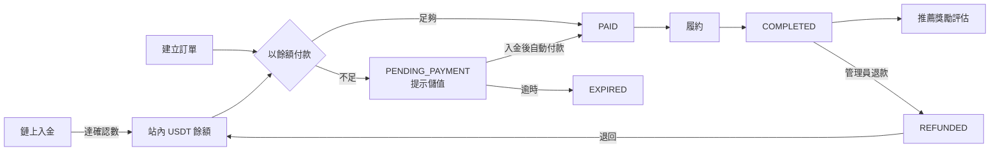
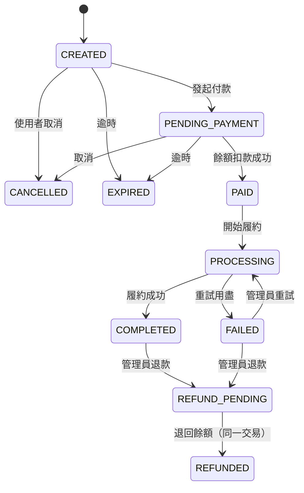

# 訂單、付款與退款流程

> 涵蓋 REQ-100 ~ REQ-117、REQ-174 ~ REQ-176、REQ-187。
> 鏈上入金如何變成站內餘額見 `CHAIN-CUSTODY.md`；記帳方式見 `WALLET-LEDGER.md` 第二部分；
> 數值與業務規則見 `BUSINESS-RULES.md`。

## 1. 全貌



- 錢進入平台只有一個管道：鏈上入金。
- 付款與退款都是帳本內部的轉帳（使用者餘額 ⇄ 營收），不依賴任何外部回呼，也不經過鏈上。
- 本期沒有任何把錢從平台轉給使用者的鏈上轉帳；出金留給未來模組（D-14、D-18）。

## 2. 商品與訂單類型

| 商品類型 | 訂單類型 | 建立者 | 履約 handler |
| --- | --- | --- | --- |
| `MEMBERSHIP_PLAN` | `MEMBERSHIP_PURCHASE`、`MEMBERSHIP_RENEWAL`、`MEMBERSHIP_UPGRADE` | 使用者 | membership |
| `MEMBERSHIP_PLAN` | `MEMBERSHIP_AUTO_RENEWAL` | 系統（自動續費排程） | membership |
| `CREDIT_PACK` | `CREDIT_PURCHASE` | 使用者 | wallet |
| `AI_SERVICE` | `AI_SERVICE` | 未來 | 未來的 AI Studio |

## 3. 建立訂單

1. 使用者呼叫 `POST /orders`，或便利端點 `POST /memberships/purchase`、`/memberships/renew`、`/memberships/upgrade`、`/wallet/credits/purchase`。便利端點內部都呼叫 `commerce.public.create_order()`。
2. 以 `Idempotency-Key` header 去重：同一個鍵 24 小時內重送，回傳同一張訂單。
3. 驗證：
   - 商品為 `ACTIVE`；數量在允許範圍內。
   - 會員方案由 membership 判斷這次購買屬於哪一種情境（`BUSINESS-RULES.md` §2.2）。不允許的情境回傳 `MEMBERSHIP_ACTION_INVALID`（附建議的操作）、`UPGRADE_NOT_ALLOWED` 或 `DOWNGRADE_NOT_ALLOWED`。
4. 計價：
   - 單價取商品目前生效的價格（`product_prices`）。
   - 升級時由 membership 計算抵扣額，填入 `discount_amount`，計算過程存入 `pricing_snapshot`。
5. 寫入：`orders`（`CREATED`）、`order_items`（價格快照）、`order_status_history`，在同一交易內。
6. 付款期限 `expires_at`：一般訂單為現在加 30 分鐘；自動續費訂單為寬限期結束時間。

## 4. 訂單狀態機



| 從 | 到 | 觸發 | 執行者 | 同一交易內的其他動作 |
| --- | --- | --- | --- | --- |
| — | `CREATED` | 建立訂單 | 使用者、系統 | 寫入明細與歷史 |
| `CREATED` | `PENDING_PAYMENT` | 發起付款 | 使用者、系統 | — |
| `CREATED` / `PENDING_PAYMENT` | `CANCELLED` | 使用者取消；關閉自動續費 | 使用者、系統 | outbox `order.cancelled` |
| `CREATED` / `PENDING_PAYMENT` | `EXPIRED` | 超過 `expires_at` | 系統 | outbox `order.expired` |
| `PENDING_PAYMENT` | `PAID` | 餘額扣款成功 | 系統 | 資金分錄 `PAYMENT`、`payment_transactions`、outbox `order.paid` |
| `PAID` | `PROCESSING` | 履約開始 | 系統 | `fulfillment_attempts + 1` |
| `PROCESSING` | `COMPLETED` | handler 成功 | 系統 | handler 的效果、outbox `order.completed` |
| `PROCESSING` | `FAILED` | 重試用盡 | 系統 | 告警 |
| `FAILED` | `PROCESSING` | 管理員重試 | Finance Administrator | 稽核日誌 |
| `COMPLETED` / `FAILED` | `REFUND_PENDING` | 管理員退款 | Finance Administrator | 與下一列在同一個交易內 |
| `REFUND_PENDING` | `REFUNDED` | 退回餘額完成 | 系統 | 資金分錄 `REFUND`、handler 反向處理、稽核日誌、outbox `order.refunded` |

實作規則：
- 轉換表寫在 `commerce/services/state_machine.py`，是唯一可以改訂單狀態的地方。
- 每次轉換執行 `UPDATE orders SET status = :to, version = version + 1 WHERE id = :id AND status = :from AND version = :v`；影響 0 列即視為衝突（`ORDER_STATE_INVALID`）。
- 每次轉換寫一列 `order_status_history`。
- `REFUND_PENDING` 在本期只存在於退款交易內。保留它是為了符合 spec 的狀態機，也方便未來接入需要非同步退款的支付方式。

## 5. 以餘額付款（REQ-174）

`POST /payments/initiate { "order_id": "…", "method": "USDT_BALANCE" }`

```text
BEGIN
  鎖訂單（SELECT … FOR UPDATE）
  訂單已 PAID 或之後的狀態 → 回傳既有付款結果（冪等）
  訂單不是 CREATED / PENDING_PAYMENT，或已逾時 → ORDER_NOT_PAYABLE
  CREATED → PENDING_PAYMENT
  funds.charge_user(user, total_amount, reference = order, key = "payment:{order_id}")
    餘額不足 → 寫入 payment_transactions(FAILED, INSUFFICIENT_BALANCE)；COMMIT；回傳 402
  寫入 payment_transactions(SUCCEEDED, journal_entry_id)
  PENDING_PAYMENT → PAID；paid_amount = total_amount；paid_at = now()
  寫入 outbox order.paid
COMMIT
```

- 同一使用者同時付兩張訂單時，`charge_user` 會鎖住使用者的餘額帳戶，兩筆依序執行；餘額只夠一張時，第二張得到 402。
- 一張訂單只會有一筆成功的付款（`payment_transactions` 的部分唯一索引保證）。

餘額不足時的回應：

```json
HTTP/1.1 402 Payment Required
{
  "error": {
    "code": "INSUFFICIENT_BALANCE",
    "message": "USDT 餘額不足",
    "details": {
      "order_id": "0193…",
      "amount_due": "30.000000",
      "balance": "12.500000",
      "shortfall": "17.500000",
      "currency": "USDT",
      "order_expires_at": "2026-11-26T10:30:00Z",
      "deposit_addresses": [
        { "chain": "TRON", "address": "T…" },
        { "chain": "BSC", "address": "0x…" }
      ]
    },
    "request_id": "…"
  }
}
```

## 6. 入金後自動付款（REQ-175）

- 訂閱 `chain.deposit_confirmed`。設定 `order.auto_pay_on_deposit` 關閉時不處理。
- 依建立時間由舊到新，取該使用者 `PENDING_PAYMENT` 且未逾時的訂單，每張訂單各自用 §5 的流程付款；餘額不足就停止。
- 自動續費訂單也在這個清單中，所以使用者在寬限期內儲值後會自動完成續費。

## 7. 履約（REQ-110）

```text
訂閱 order.paid：
  交易 1：PAID → PROCESSING，fulfillment_attempts + 1；COMMIT
  交易 2：鎖訂單；確認仍為 PROCESSING
          handler = registry[order_item.product_type]
          handler.fulfill(order_item, ctx)     # 冪等鍵：order_item.id
          PROCESSING → COMPLETED；寫入 outbox order.completed
          COMMIT
  交易 2 失敗：依 1 分、5 分、15 分、1 小時、3 小時重試；
              第 5 次仍失敗 → PROCESSING → FAILED，告警
```

- 拆成兩個交易，`PROCESSING` 才看得到，履約卡住時也查得出來。
- 排程每 10 分鐘找出停在 `PROCESSING` 超過 30 分鐘、且沒有在重試的訂單，重新送進履約流程。
- handler 是冪等的，重複執行不會重複開通或入帳。
- **管理員重試**：`FAILED` 的訂單修正問題後，由 Finance Administrator 觸發重試，回到 `PROCESSING`；`fulfillment_attempts` 歸零。

各 handler 的履約內容：

| handler | `fulfill()` |
| --- | --- |
| membership | 依訂單類型建立或排定會員期間（`BUSINESS-RULES.md` §2），寫入會員異動歷史，發放第一個週期的會員點數；升級時收回舊週期點數 |
| wallet（點數包） | `wallet.grant(PURCHASED, 點數 × 數量, source = 訂單)` |

## 8. 取消與逾時（REQ-104、REQ-105）

- 使用者可取消 `CREATED`、`PENDING_PAYMENT` 的訂單。
- 排程每分鐘把超過 `expires_at` 的 `CREATED`、`PENDING_PAYMENT` 訂單轉為 `EXPIRED`。
- 訂單逾時後才到的入金，照常進入使用者的站內餘額；使用者可以重新下單。舊版設計中「逾時後才付款」的例外（REQ-115）因此不再存在。

## 9. 自動續費訂單（REQ-176）

時間點見 `BUSINESS-RULES.md` §2.7。與一般訂單的差異：

| 項目 | 自動續費訂單 |
| --- | --- |
| 建立者 | 系統，冪等鍵 `membership:{membership_id}:renew:{period_no}` |
| 價格 | 續費當下生效的價格；有排定降級時用降級後的方案 |
| 付款期限 | 寬限期結束時間 |
| 付款嘗試 | 到期前每 6 小時、寬限期內每天一次，另加入金後自動付款 |
| 取消 | 使用者關閉自動續費時，系統轉 `CANCELLED` |
| 逾時 | 會員轉 `EXPIRED`，使用者回到 Free，發出 `membership.renewal_failed` |

## 10. 退款（REQ-187、D-06、D-18）

退款不經過鏈上：金額退回使用者的站內 USDT 餘額。使用者要把錢轉出平台，要等未來的出金功能（D-14）。

### 10.1 流程

`POST /admin/refunds { order_id, amount, reason, reference }`（需要 `refund.manage` 權限）

```text
BEGIN
  鎖訂單
  驗證：訂單為 COMPLETED 或 FAILED、已付款、尚未退款
        amount ≤ paid_amount；有原因與工單號
  COMPLETED / FAILED → REFUND_PENDING
  寫入 refund_records(COMPLETED)
  funds.post(REFUND：借 SALES_REFUNDS、貸 USER_BALANCE(使用者), key = "refund:{refund_id}")
  寫入 payment_transactions(kind = REFUND, journal_entry_id, refund_id)
  handler.reverse(order_item, refund)          # 會員、點數的反向處理（§10.2）
  REFUND_PENDING → REFUNDED；更新 refunded_amount、payment_status
  寫入 admin_audit_logs
  寫入 outbox order.refunded                   # referral 取消或沖回獎勵；通知使用者
COMMIT
```

- 任何一步失敗，整個交易回滾，訂單維持原狀態，管理員看到錯誤訊息。
- 同一張訂單本期只能退款一次（`refund_records` 的唯一索引）。
- 一位管理員即可完成。所有退款都寫入稽核日誌，財務可在後台定期抽查。

### 10.2 反向處理

| handler | `reverse()` |
| --- | --- |
| membership | 該訂單產生的會員期間 → `REVOKED`，立即失效；收回該期間未用完的會員點數；寫入會員異動歷史 |
| wallet（點數包） | `wallet.revoke_by_source(訂單)`：收回該批次剩餘點數 |
| referral（訂閱 `order.refunded`） | 依退款比例取消或沖回獎勵（`REFERRAL-FLOW.md` §6） |

### 10.3 例外

| 情況 | 處理 |
| --- | --- |
| 反向處理失敗（例如資料不一致） | 整筆回滾、不退款；告警，修正後重新退款 |
| 點數包的點數已全部用完 | 照常退款，沒有剩餘點數可扣回；金額由管理員決定 |
| 退錯了 | 退款記錄不能修改或刪除；需要時由 Super Administrator 以資金帳本的 `ADJUSTMENT` 分錄更正（雙人核准） |

## 11. 事件

| 事件 | 發出者 | 訂閱者 |
| --- | --- | --- |
| `order.paid` | commerce | commerce（履約） |
| `order.completed` | commerce | referral（獎勵評估、付費數統計）、notifications |
| `order.cancelled`、`order.expired` | commerce | membership（自動續費訂單逾時的後續處理）、notifications |
| `order.refunded` | commerce | referral（取消或沖回獎勵）、notifications |
| `chain.deposit_confirmed` | chain | payments（自動付款）、notifications |
| `chain.transfer_confirmed`、`chain.transfer_failed` | chain | chain（歸集與補手續費的記帳） |
| `refund.completed` | payments | notifications、reporting |

## 12. spec §12 支付測試的對應

| spec 情境 | 本設計的測試 |
| --- | --- |
| Successful payment callback | 入金達確認數後餘額增加；以餘額付款成功並完成履約；入金後自動付款 |
| Invalid signature | 非官方合約的轉帳不入帳；未達確認數不入帳；大額入金第二來源不一致時不入帳 |
| Duplicate callback | 同一筆鏈上轉帳重複掃描只入帳一次；同一訂單重複付款請求只扣一次；50 個並發付款請求只成功一次 |
| Payment timeout | 未付款訂單逾時轉 `EXPIRED`；逾時後的入金留在餘額 |
| Refund processing | 退款後使用者餘額增加、會員失效、點數收回、獎勵沖回，全部在同一交易內；任一步失敗整筆回滾；同一訂單不能退兩次；沒有 `refund.manage` 權限被拒 |
