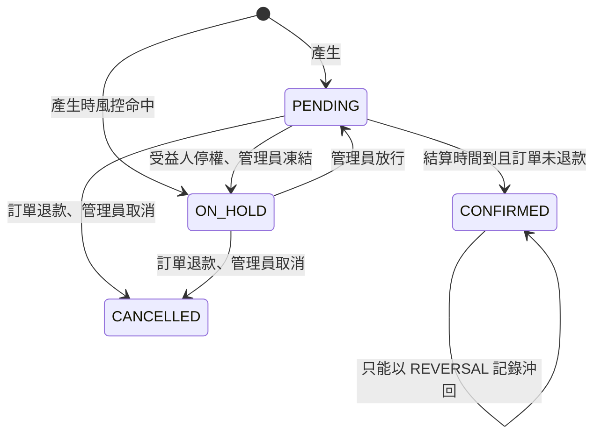

# 推薦流程

> 涵蓋 REQ-060 ~ REQ-069、REQ-071 ~ REQ-078、REQ-124。
> 獎勵層數由管理員設定（`referral.reward_levels`，1 ~ 10，預設 1 = 只發給直接推薦人；D-19）。這一點覆蓋了 spec §5「只做單層直推」的限制。
> 獎勵以 USDT 計價、只記帳不提領（D-02），與 AI 點數、USDT 資金帳本分開（REQ-075）。
> 資料表見 `DATABASE-ERD.md` §11；數值規則見 `BUSINESS-RULES.md` §6。

## 1. 推薦碼

### 1.1 產生
```text
generate_code():
  alphabet = "23456789ABCDEFGHJKMNPQRSTUVWXYZ"          # 31 個字元
  random_part = 從 alphabet 以 secrets.choice 取 referral.code_length 個字元
  code = referral.code_prefix + random_part
  INSERT referral_codes(code, status = 'ACTIVE')
  唯一鍵衝突 → 重試，最多 5 次；仍失敗則告警（代表長度太短）
```
- 使用密碼學安全亂數（Python `secrets`），不使用流水號或可推算的值（REQ-060）。
- 預設長度 8，組合數約 8.5 × 10¹¹；搭配驗證 API 的限流，無法有效猜測。
- 帳號啟用時，在同一個交易內產生（D-13）。

### 1.2 正規化與比對
- 輸入時去除空白與連字號，轉為大寫，再查 `referral_codes.code`（儲存時已是大寫），因此不分大小寫（REQ-061）。
- 格式不符（長度、字元集）直接判定無效，不查資料庫。

### 1.3 推薦連結與 QR code
- 連結格式：`{PUBLIC_WEB_BASE_URL}/register?ref={CODE}`。`PUBLIC_WEB_BASE_URL` 是環境變數。
- API 回傳連結字串；QR code 由前端依連結產生（不增加後端依賴），前端另提供一鍵複製（REQ-062）。

### 1.4 重新產生與停用（REQ-063）

| 動作 | 執行者 | 條件 | 結果 |
| --- | --- | --- | --- |
| 重新產生 | 會員 | 距上次產生滿 30 天，且推薦碼不是 `SUSPENDED` | 舊碼 → `INACTIVE`，產生新碼；舊連結失效 |
| 停用 | Member Support 或 Operations Administrator | 需填原因 | 碼 → `SUSPENDED`；會員不能自行重新產生 |
| 恢復 | 同上 | 需填原因 | `SUSPENDED` → `ACTIVE` |

所有已建立的推薦關係都不受影響（REQ-067）。

## 2. 連結造訪追蹤（REQ-068）

1. 訪客開啟帶有 `?ref=` 的頁面，前端若沒有匿名訪客 ID cookie（`pl_vid`，隨機 UUID，有效 1 年），就產生一個。
2. 前端呼叫 `POST /referrals/visits { code, visitor_id }`（公開、限流）。
3. 後端只在推薦碼有效時記錄；以 `(referral_code_id, sha256(visitor_id))` 去重；IP 只存雜湊。
4. 回應一律 `204`，不透露推薦碼是否有效。

## 3. 推薦碼驗證 API（REQ-064）

`POST /referrals/validate { "code": "ref8k29x" }` → `200 { "valid": true }` 或 `200 { "valid": false }`

- 不回傳推薦人的任何資料。
- 限流：每個 IP 每分鐘 20 次。

## 4. 綁定（REQ-065 ~ REQ-067）

### 4.1 流程
1. 註冊時，推薦碼存入 `users.signup_referral_code`，並先檢查一次是否有效（無效則註冊失敗，讓使用者修正）。
2. 使用者完成驗證時，identity 在同一交易內發出 `user.activated`；referral 的交易內訂閱者執行：

```text
on_user_activated(referee):
  產生 referee 自己的推薦碼                            # §1.1
  若 referee.signup_referral_code 為空 → 結束
  code = 查詢正規化後的推薦碼
  依序檢查（BUSINESS-RULES §6.2）：
    推薦碼存在且 ACTIVE                     否則 CODE_INVALID
    推薦人 ACTIVE 且推薦資格未被停用         否則 REFERRER_INELIGIBLE
    推薦人 ≠ referee                         否則 SELF_REFERRAL
    referee 尚未綁定                         否則 ALREADY_BOUND
    referee 不在推薦人的上線鏈中             否則 CIRCULAR
  全部通過 →
    INSERT referral_bindings（記錄推薦人 ID、使用的推薦碼 ID 與字串、referee 的註冊 IP 與裝置雜湊）
    寫入 referee 的上線鏈                                # §4.3
  寫入 referral_bind_attempts（結果）
  通過時寫入 outbox referral.bound
```

- 檢查不通過不會讓驗證失敗；結果記在 `referral_bind_attempts`，後台可查。
- 「被推薦人只能有一位推薦人」由 `referral_bindings.referee_id` 的唯一約束保證；「不能自我推薦」由 `CHECK (referee_id <> referrer_id)` 保證；「綁定後不可修改」由 `forbid_mutation()` 觸發器保證（REQ-066）。

### 4.2 為什麼不會有循環
綁定只發生在被推薦人「剛啟用」的那一刻。被推薦人在此之前沒有推薦碼，不可能有人透過他註冊，所以他不可能是任何人的上線，也就不會形成 A → B → A，或更長的 A → B → C → A。
程式仍保留 `CIRCULAR` 檢查（被推薦人不得出現在推薦人的上線鏈中），以防未來開放其他綁定方式。

### 4.3 上線鏈（REQ-076）
推薦人是被推薦人的第 1 層上線，推薦人的推薦人是第 2 層，依此類推。綁定成功時，在同一交易內把被推薦人的上線鏈寫入 `referral_ancestors`：

```text
write_ancestors(referee, referrer):
  INSERT referral_ancestors(user_id = referee, ancestor_id = referrer, depth = 1)
  INSERT referral_ancestors(user_id, ancestor_id, depth)
    SELECT referee, ancestor_id, depth + 1
    FROM referral_ancestors
    WHERE user_id = referrer AND depth < REFERRAL_MAX_DEPTH      # 10
```

- 推薦人自己的上線鏈在他啟用時就已寫好，這裡只要複製並加一層，不需要遞迴查詢。
- 每位使用者最多記錄 10 層上線（程式常數 `REFERRAL_MAX_DEPTH`，也是層數設定的上限）。不論目前設定幾層都記滿，之後調高層數不需要補資料。
- 只能新增（`forbid_mutation()`）。綁定不可修改，所以上線鏈也永遠不變。
- 用途：找出第 1 ~ N 層上線發獎勵（§5.3）、儀表板分層統計（§7）、後台查看某位會員的上線與各層下線人數。

範例：A 推薦 B，B 推薦 C，C 推薦 D。

| 使用者 | 第 1 層 | 第 2 層 | 第 3 層 |
| --- | --- | --- | --- |
| B | A | | |
| C | B | A | |
| D | C | B | A |

## 5. 獎勵引擎（REQ-071 ~ REQ-075、REQ-077）

### 5.1 層數（D-19）
- 管理員在系統設定輸入層數 `referral.reward_levels`（整數 1 ~ 10，預設 1）。修改需要 `referral.rule.manage` 權限，並寫入稽核日誌。
- 層數 N 的意思：訂單完成時，購買者往上第 1 ~ N 層的上線都可能得到獎勵。第 1 層就是直接推薦人。
- 預設 1，行為與 spec §5 的「只發給直接推薦人」相同。設為 2 以上之前需要法務確認：多層獎勵可能受多層次傳銷相關法規規範（D-17、D-19）。
- 修改只影響之後完成的訂單：評估獎勵時讀取當下的設定值，並記在 `rule_snapshot`。已產生的獎勵不受影響；調降層數也不會取消已產生的深層獎勵，需要取消時用 §6 的管理員取消。
- 每一層發多少由規則決定（§5.2）；規則沒有設定的層不發。

### 5.2 規則欄位

規則本身（`referral_reward_rules`）：

| 欄位 | 說明 |
| --- | --- |
| `min_order_amount` | 訂單實付金額至少要達到的金額 |
| `eligible_product_types` | 適用的商品類型，例如 `{MEMBERSHIP_PLAN}` |
| `campaign_code`、`starts_at`、`ends_at` | 活動代碼與期間；以訂單完成時間判斷 |
| `settlement_delay_days` | 結算延遲天數（各層相同） |
| `first_purchase_only` | 只限購買者的第一筆完成訂單 |
| `max_rewards_per_referee` | 同一位購買者在這條規則下，最多幾張訂單可以產生獎勵（一張訂單不論發幾層都算一次） |
| `priority` | 多條規則同時符合時，取數字最大的一條 |

每一層的獎勵（`referral_reward_rule_levels`）：

| 欄位 | 說明 |
| --- | --- |
| `level` | 1 ~ 10；必須從 1 開始連續設定 |
| `reward_type` | `FIXED`：固定金額；`PERCENT`：訂單實付金額的百分比（以萬分比 `percent_bps` 表示，1000 = 10%） |
| `fixed_amount` / `percent_bps` / `max_reward_amount` | 金額、比例、這一層的單筆獎勵上限 |

存檔時檢查：
- 至少要有第 1 層，且層級從 1 開始連續。
- 各層 `percent_bps` 合計不超過 10000（100%）。
- 規則可以設定比目前層數 N 更多的層，多出來的層暫時不發；後台存檔時提示。

規則可以修改；已產生的獎勵保存當時的規則快照（`rule_snapshot`，含各層設定與當時的 N），不受之後的修改影響。

### 5.3 評估演算法

```text
訂閱 order.completed(order)：
  buyer = order.user
  若 buyer 沒有推薦綁定 → 結束
  更新 referral_referee_activity（付費數統計）
  N = 系統設定 referral.reward_levels（此刻的值）
  paid = order.paid_amount
  candidates = 所有 ACTIVE 規則，且：
      order 的商品類型 ∈ eligible_product_types
      paid ≥ min_order_amount
      order.completed_at 在 [starts_at, ends_at) 內（未設定視為不限）
      first_purchase_only → 這是 buyer 第一筆 COMPLETED 訂單
      max_rewards_per_referee → buyer 在此規則下「有未取消獎勵的訂單數」< 上限
  rule = candidates 中 priority 最大者（相同時取建立較早者）；沒有 → 結束
  remaining = paid                                    # 各層合計不超過實付金額
  for (beneficiary, L) in buyer 的上線鏈中 depth 1 ~ N 的上線，由近到遠：
      lv = rule 第 L 層的設定；沒有 → 結束迴圈          # 層級連續，更遠的層也不會有
      若 beneficiary 不是 ACTIVE，或推薦資格被停用 → 跳過這一層（不往上遞補）
      amount = lv.fixed_amount                                  （FIXED）
             = floor(paid × lv.percent_bps ÷ 10000)             （PERCENT）
      amount = min(amount, lv.max_reward_amount（有設定時）, remaining)
      amount = 0 → 跳過這一層
      remaining -= amount
      status = 風控檢查（§8，buyer 對 beneficiary）命中 ? ON_HOLD : PENDING
      INSERT referral_rewards(kind = REWARD, level = L, beneficiary_id = beneficiary,
                              amount, status,
                              settle_at = order.completed_at + rule.settlement_delay_days,
                              rule_snapshot, base_amount = paid)
  # 一張訂單的各層獎勵在同一交易寫入
  # referral_rewards(order_id, level) WHERE kind = 'REWARD' 的唯一索引保證同一張訂單每層只產生一次；
  # 事件重送時唯一鍵衝突，視為已處理
```

### 5.4 範例

單層（N = 1，每條規則只設第 1 層）：

| 規則 | 訂單 | 獎勵 |
| --- | --- | --- |
| 固定 5 USDT，適用會員方案，最低 10 USDT | 會員月費 30 USDT | 5 USDT |
| 10%，上限 20 USDT，適用會員方案與點數包 | 會員年費 300 USDT | min(30, 20) = 20 USDT |
| 15%，只限首購，優先序 10；另有固定 3 USDT，優先序 1 | 第一筆點數包 50 USDT | 7.5 USDT（首購規則優先） |
| 同上 | 第二筆點數包 50 USDT | 3 USDT（首購規則不再符合） |
| 10% | 升級訂單，實付 24.838710 USDT | 2.483871 USDT |

多層：規則為第 1 層 10%、第 2 層 5%、第 3 層 2%（上限 5 USDT），適用會員方案。推薦關係同 §4.3（D 的上線依序是 C、B、A）。

| 層數 N | 情境 | 獎勵 |
| --- | --- | --- |
| 1 | D 買會員年費 300 USDT | C 30 |
| 3 | 同上 | C 30、B 15、A min(6, 5) = 5 |
| 3 | 同上，但 B 已被停權 | C 30、A 5（B 這一層不發，也不遞補給別人） |
| 3 | B 買會員月費 30 USDT（B 只有一層上線） | A 3 |
| 3 | 規則只設了第 1、2 層 | C 30、B 15 |
| 2 | 另一條規則：第 1 層固定 20、第 2 層固定 20；D 的訂單實付 30 USDT | C 20、B 10（合計不超過實付金額） |

## 6. 獎勵狀態與結算



- 每一層的獎勵是各自獨立的一筆記錄，分別結算、凍結、取消與沖回。
- **結算**（REQ-073）：排程每小時處理 `PENDING` 且 `settle_at <= now()` 的獎勵。查詢訂單狀態：
  - 訂單在 `REFUND_PENDING`：這次跳過，等退款結果。
  - 其他情況：轉為 `CONFIRMED`，發出 `referral.reward_confirmed`。
- **退款連動**（REQ-074，訂閱 `order.refunded`）：對這張訂單每一層的獎勵分別處理：
  - `PENDING` / `ON_HOLD` → `CANCELLED`。
  - `CONFIRMED` → 新增 `REVERSAL` 記錄，金額 = −floor(原獎勵 × 退款金額 ÷ 實付金額)；全額退款時等於 −原獎勵。
- **管理員操作**（REQ-124，需 `referral.reward.review` 權限，全部寫入稽核日誌）：
  - 凍結：`PENDING` → `ON_HOLD`。
  - 放行：`ON_HOLD` → `PENDING`；若 `settle_at` 已過，下次排程即確認。
  - 取消：`PENDING` / `ON_HOLD` → `CANCELLED`。
  - 沖回：對 `CONFIRMED` 獎勵新增 `REVERSAL`，金額不超過尚未沖回的部分。
  - 以上操作都必須填原因。
- 原記錄的金額永遠不改，只改狀態或新增反向記錄（`guard_referral_reward()` 觸發器保證）。

## 7. 推薦儀表板（REQ-069、REQ-078）

| 指標 | 定義 |
| --- | --- |
| 推薦碼、推薦連結 | 目前 `ACTIVE` 的推薦碼與連結 |
| 邀請數 | 該會員所有推薦碼（含已停用的）的唯一造訪數 |
| 註冊數 | `referral_bindings` 中推薦人是該會員的筆數（第 1 層） |
| 付費數 | `referral_referee_activity` 中推薦人是該會員的筆數（第 1 層中至少有一筆完成訂單的人） |
| 分層統計 | 第 1 ~ N 層各層的註冊數與付費數（N = 目前的 `referral.reward_levels`） |
| 待結算金額 | 受益人是該會員的 `REWARD` 中，`PENDING` + `ON_HOLD` 的金額合計，含所有層（會員端不顯示凍結原因） |
| 已確認金額 | 受益人是該會員的 `REWARD` 中 `CONFIRMED` 的金額 + 所有 `REVERSAL` 的金額 |
| 獎勵歷史 | 每筆獎勵與沖回：日期、層級、訂單編號（遮罩）、金額、狀態 |

分層統計的查詢：

```sql
SELECT a.depth AS level, count(*) AS registered, count(act.referee_id) AS paying
FROM referral_ancestors a
LEFT JOIN referral_referee_activity act ON act.referee_id = a.user_id
WHERE a.ancestor_id = :member_id AND a.depth <= :reward_levels
GROUP BY a.depth
ORDER BY a.depth;
```

- N = 1 時，前端不顯示分層區塊，畫面與單層版本相同。
- `GET /referrals/me/members?level=L` 列出第 L 層的下線（預設第 1 層，最多到第 N 層），只回傳遮罩後的 username（例如 `ja***`）、註冊日期、是否已付費；不顯示這位下線是透過誰加入的。

## 8. 風控

| 訊號 | 處理 |
| --- | --- |
| 購買者的註冊 IP 或裝置雜湊，與受益人最近 30 天的登入記錄相同 | 該層獎勵產生時直接 `ON_HOLD`，原因 `SAME_IP_OR_DEVICE`；每一層分別比對 |
| 推薦人 24 小時內新增的直接綁定數超過 `referral.risk_daily_binding_alert` | 告警，由營運決定是否停用推薦碼 |
| 受益人被停權 | 該受益人所有 `PENDING` 獎勵轉 `ON_HOLD` |
| 結算延遲 | 讓退款有時間發生，避免先付款拿獎勵再退款 |
| 層數 | 預設 1。層數越多，自建一串假帳號能拿到的獎勵越多；調高前先檢視上面這些訊號的數據 |

受益人最近的登入 IP 透過 `identity.public.recent_login_fingerprints(user_id, days)` 取得，referral 不直接讀 identity 的資料表。

## 9. spec §12 推薦測試的對應

| spec 情境 | 測試 |
| --- | --- |
| Unique referral code generation | 大量產生無重複；碰撞時重試；字元集與長度正確；不可由使用者 ID 推算 |
| Successful referral binding | 帶推薦碼註冊並驗證後，綁定建立且記錄推薦碼快照 |
| Invalid referral code | 註冊時無效碼被拒；驗證當下推薦碼已停用則不綁定並記錄 `CODE_INVALID` |
| Self-referral rejection | 服務層拒絕；資料庫 `CHECK` 也拒絕 |
| Duplicate referral binding | 同一被推薦人第二次綁定被唯一約束拒絕；綁定記錄無法更新或刪除 |
| Reward calculation | 固定、百分比、上限、首購、優先序、活動期間、最低金額；同一訂單只產生一次 |
| Refund-related reward reversal | 待結算獎勵被取消；已確認獎勵依比例新增沖回記錄；原記錄金額不變；多層時每一層都被處理 |
| （新增）上線鏈 | 綁定時複製推薦人的上線鏈並加一層；最多 10 層；不可修改或刪除；被推薦人出現在推薦人上線鏈中時記錄 `CIRCULAR` |
| （新增）多層獎勵 | N = 1 只發第 1 層；N = 3 發三層且各層金額正確；上線不足 N 層時只發現有的層；不符資格的層跳過、不遞補；各層合計不超過實付金額；同一張訂單每層只產生一次；修改 N 只影響之後完成的訂單 |
