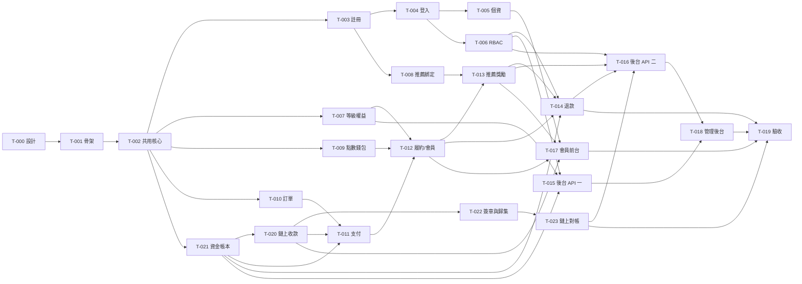

# Pinklin Phase 1 — Task Breakdown

把 [PRD](PRD-project.md) 的需求分組成任務並排定順序。這裡只做粗粒度規劃，
細節寫在每個任務的 Level-2 TECH（`docs/tasks/T-NNN-slug/`）。
**Status 欄位是整個專案進度的唯一依據。**

任務順序遵循 spec §13 Step 3：基礎設施 → 身分驗證 → 會員 → 推薦 → 錢包 → 訂單支付 → 後台 → 整合測試。
USDT 鏈上收款（T-020 ~ T-023）屬於「訂單支付」階段，但沒有依賴身分與會員任務，可以提早平行進行。

## Tasks

| Task  | Title | REQs | Depends on | Phase | Status |
| ----- | ----- | ---- | ---------- | ----- | ------ |
| T-000 | 技術設計文件（spec §13 Step 2 的 9 份 + CHAIN-CUSTODY）：草稿全部完成，審閱通過後各文件改為 approved | — | — | P0 設計 | in-review |
| T-001 | 專案骨架：Django / Next.js monorepo、Docker Compose、環境設定、OpenAPI、錯誤格式、模組邊界檢查、日誌、CI | REQ-001, REQ-002, REQ-003, REQ-004, REQ-005, REQ-008, REQ-151, REQ-154, REQ-155, REQ-156, REQ-162 | T-000 | P0 基礎 | pending |
| T-002 | 共用核心：outbox 領域事件、Celery 排程、系統設定、稽核日誌、限流 | REQ-006, REQ-007, REQ-129, REQ-152 | T-001 | P0 基礎 | pending |
| T-003 | 註冊與驗證：email / 手機註冊、驗證碼、唯一性、密碼政策、帳號狀態 | REQ-010, REQ-011, REQ-012, REQ-013, REQ-014, REQ-015, REQ-016, REQ-153 | T-002 | P1 身分 | pending |
| T-004 | 登入與 Session：JWT、refresh 輪替與重放偵測、登出撤銷、忘記密碼、防暴力破解、安全稽核、CSRF | REQ-017, REQ-018, REQ-019, REQ-020, REQ-021, REQ-025, REQ-150 | T-003 | P1 身分 | pending |
| T-005 | 個人資料與頭像 | REQ-022, REQ-023, REQ-024 | T-004 | P1 身分 | pending |
| T-006 | RBAC、內建後台角色、管理員帳號、強制 TOTP、初始超管指令 | REQ-009, REQ-030, REQ-031, REQ-032, REQ-033, REQ-034, REQ-035 | T-004 | P1 身分 | pending |
| T-007 | 會員等級與權益設定、權益驗證服務、每日用量計數 | REQ-040, REQ-041, REQ-043, REQ-050, REQ-052 | T-002 | P2 核心業務 | pending |
| T-008 | 推薦碼產生與綁定：唯一碼、連結與 QR、驗證 API、綁定規則、上線鏈、造訪追蹤 | REQ-060, REQ-061, REQ-062, REQ-063, REQ-064, REQ-065, REQ-066, REQ-067, REQ-068, REQ-076 | T-003 | P2 核心業務 | pending |
| T-009 | 點數錢包核心：批次、不可變帳本、扣點優先序、冪等、併發、到期、對帳 | REQ-080, REQ-081, REQ-082, REQ-084, REQ-085, REQ-086, REQ-087, REQ-088, REQ-089, REQ-090, REQ-091, REQ-092, REQ-093 | T-002 | P2 核心業務 | pending |
| T-010 | 商品目錄與訂單：建立訂單、訂單編號、狀態機、取消、逾時、金額與幣別表示、會員訂單查詢 | REQ-100, REQ-101, REQ-102, REQ-103, REQ-104, REQ-105, REQ-116, REQ-117 | T-002 | P3 商務 | pending |
| T-011 | 支付：支付方式抽象、以站內餘額付款、入金後自動付款、付款紀錄 | REQ-106, REQ-112, REQ-114, REQ-174, REQ-175 | T-010, T-020, T-021 | P3 商務 | pending |
| T-012 | 履約與會員生命週期：方案定價、購買/續費/升降級/到期、自動續費、會員點數發放、點數包入帳、到期提醒 | REQ-042, REQ-044, REQ-045, REQ-046, REQ-047, REQ-048, REQ-049, REQ-051, REQ-053, REQ-083, REQ-110, REQ-176 | T-007, T-009, T-011 | P3 商務 | pending |
| T-013 | 推薦獎勵引擎（層數由管理員設定）與推薦儀表板 | REQ-069, REQ-071, REQ-072, REQ-073, REQ-074, REQ-075, REQ-077, REQ-078, REQ-111 | T-008, T-012 | P3 商務 | pending |
| T-014 | 管理員退款至站內餘額與反向處理（會員、點數、獎勵） | REQ-094, REQ-187 | T-006, T-012, T-013, T-021 | P3 商務 | pending |
| T-015 | 後台 API（一）：會員管理、會員詳情彙整、會員等級管理、系統管理 | REQ-121, REQ-122, REQ-123, REQ-128 | T-006, T-007, T-021 | P4 後台 | pending |
| T-016 | 後台 API（二）：儀表板、推薦管理、點數錢包管理與調整、訂單管理、資金管理、報表匯出 | REQ-120, REQ-124, REQ-125, REQ-126, REQ-127, REQ-185 | T-006, T-013, T-014, T-023 | P4 後台 | pending |
| T-017 | 會員前台 Web | REQ-140, REQ-142, REQ-143, REQ-144 | T-005, T-012, T-013, T-020 | P5 前端 | pending |
| T-018 | 管理後台 Web | REQ-141 | T-015, T-016 | P5 前端 | pending |
| T-019 | 整合測試（含測試網端到端）、品質驗收與交付文件 | REQ-160, REQ-161, REQ-163 | T-014, T-017, T-018, T-023 | P6 驗收 | pending |
| T-020 | 鏈上收款：HD 入金地址、TRON / BNB Chain 掃描、確認數與重組、入帳冪等、Mock 鏈、入金頁安全、異常入金 | REQ-107, REQ-170, REQ-171, REQ-172, REQ-182, REQ-184 | T-021 | P3 資金 | pending |
| T-021 | USDT 資金帳本（複式記帳）與餘額查詢 API | REQ-173, REQ-186 | T-002 | P3 資金 | pending |
| T-022 | 簽章服務、冷熱錢包與限額、歸集與手續費補充 | REQ-177, REQ-178, REQ-180 | T-020 | P3 資金 | pending |
| T-023 | 鏈上對帳與風險篩查掛勾 | REQ-181, REQ-183 | T-022 | P3 資金 | pending |

Status ∈ `pending | in-progress | in-review | done | blocked`.

## Ordering

- **關鍵路徑**：T-000 → T-001 → T-002 → T-021 → T-020 → T-011 → T-012 → T-013 → T-014 → T-016 → T-018 → T-019。
- **可平行**：T-002 完成後，「T-003 → T-004」、T-007、T-009、T-010、「T-021 → T-020 → T-022 → T-023」可以同時進行。
- **鏈上任務的外部前置**：T-020 開始前需要 TRON 與 BNB Chain 的 RPC 存取（測試網即可）；T-022 進入 staging 前需要 D-15（私鑰保管方式）定案。
- **測試隨任務撰寫**（spec §15 第 10 條）：每個任務都要有自己的 TEST-SPEC 與 RED → GREEN 測試；T-019 只負責跨模組的端到端情境、測試網流程，以及驗證 spec §12 全部情境都已覆蓋。
- **前端可提早開工**：T-017 / T-018 可以在 API 契約（OpenAPI）定稿後先對 Mock 開發，但要等依賴的後端任務完成才能標為 `done`。

## REQ coverage

每條有效 REQ 只屬於一個任務；被取代的 REQ（REQ-070、REQ-108、REQ-109、REQ-113、REQ-115、REQ-179）不再指派。
新增 REQ 時，必須在同一次變更中擴充現有任務或新增任務。

| 區域 | REQ 範圍 | 任務 |
| --- | --- | --- |
| 平台 | REQ-001~009 | T-001、T-002、T-006（REQ-009） |
| 身分驗證 | REQ-010~025 | T-003、T-004、T-005 |
| RBAC | REQ-030~035 | T-006 |
| 會員等級 | REQ-040~053 | T-007、T-012 |
| 推薦關係 | REQ-060~069、REQ-076 | T-008、T-013（REQ-069） |
| 推薦獎勵 | REQ-071~075、REQ-077、REQ-078 | T-013 |
| 點數錢包 | REQ-080~094 | T-009、T-012（REQ-083）、T-014（REQ-094） |
| 訂單支付 | REQ-100~117 | T-010、T-011、T-012（REQ-110）、T-013（REQ-111）、T-020（REQ-107） |
| 後台 | REQ-120~129 | T-015、T-016、T-002（REQ-129） |
| 前端 | REQ-140~144 | T-017、T-018 |
| 安全 | REQ-150~156 | T-001、T-002、T-003、T-004 |
| 品質交付 | REQ-160~163 | T-019、T-001（REQ-162） |
| USDT 收款與餘額 | REQ-170~176、182、184、186、187 | T-020、T-021、T-011（REQ-174、175）、T-012（REQ-176）、T-014（REQ-187） |
| 鏈上資金營運 | REQ-177、178、180、181、183、185 | T-022、T-023、T-016（REQ-185） |

## Change log
- 2026-11-26 — Baseline breakdown（T-000 ~ T-019）。
- 2026-11-26 — 依 PRD 決策 D-01 ~ D-06：新增 T-020 ~ T-023（鏈上收款、資金帳本、簽章與歸集、鏈上對帳）；T-011 改為餘額付款；T-012 加入自動續費；T-014 改為管理員手動退款；T-016 加入資金管理；移除被取代的 REQ-108、109、113、115。
- 2026-11-26 — T-000 → in-review：10 份設計文件草稿完成。
- 2026-11-26 — 依 D-18：T-014 改為退款至站內餘額（REQ-187 取代 REQ-179），改依賴 T-021，不再依賴 T-022。
- 2026-11-26 — 依 D-19：T-008 改為 REQ-076（上線鏈，取代 REQ-070）；T-013 加入 REQ-077（層數與分層獎勵）、REQ-078（分層儀表板）。
